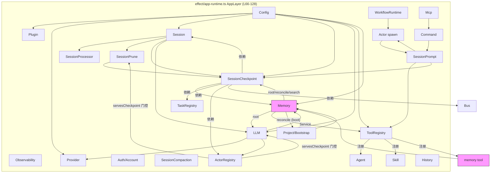
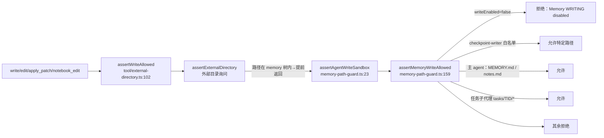
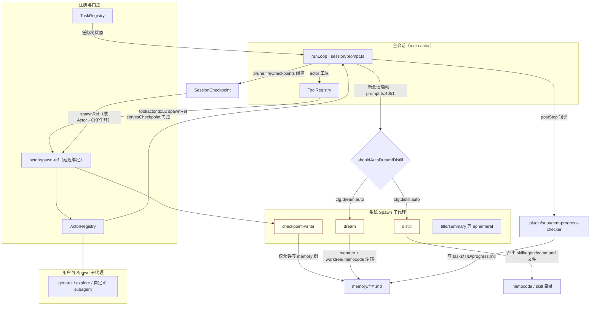

# Arch-Audit-04 · Echo Core / MiMoCode 模块依赖与数据流审计

> 审计对象：`D:\EchoCore\MiMo-Code\packages\cli\src\`（只读）
> 日期：2026-07-11
> 证据等级标注：**实际调用**（运行时代码路径）/ **接口声明**（类型存在但无调用方）/ **理论关系**（注释/设计意图）/ **不存在**

---

## 1. 整体模块依赖图

### 1.1 顶层模块清单（src/ 一级目录）

`account` `acp` `actor` `agent` `auth` `bus` `cli` `command` `config` `control-plane` `cron` `effect` `env` `error` `file` `flag` `format` `git` `global` `history` `id` `ide` `inbox` `installation` `llm-server` `lsp` `mcp` `memory` `metrics` `npm` `patch` `permission` `plugin` `project` `provider` `pty` `question` `server` `session` `share` `shell` `skill` `snapshot` `storage` `sync` `task` `team` `tool` `util` `workflow` `worktree`

### 1.2 核心运行时模块依赖图（Effect Layer 图，按 app-runtime 组装顺序）



**Layer 依赖声明（实际接口）**：

| Layer | 声明位置 | 直接 Memory 依赖 |
|---|---|---|
| SessionCheckpoint | `session/checkpoint.ts:620-623` | `Session \| Bus \| Config \| Memory \| TaskRegistry \| ActorRegistry` — **实际调用** |
| LLM | `session/llm.ts:280-286` | `… \| Memory.Service` — **实际调用** |
| ToolRegistry | `tool/registry.ts:164,518` | yield MemoryTool；`Memory.defaultLayer` 提供 — **实际调用** |
| AppLayer | `effect/app-runtime.ts:118` | `Memory.defaultLayer` 合并 — **实际调用** |
| BootstrapLayer | `effect/bootstrap-runtime.ts:29` | `Memory.defaultLayer` — **实际调用** |
| InstanceBootstrap | `project/bootstrap.ts:17,52` | `Memory.Service.use(svc.reconcile())` forkDetach — **实际调用** |

### 1.3 Memory 子模块内部结构

```
memory/
  index.ts          → export * as Memory from "./service"
  service.ts        → Context.Service("@opencode/Memory")；API = root | reconcile | search（无写 API）
  write-gate.ts     → isMemoryWriteEnabled(cfg)（纯函数，无 Service）
  reconcile.ts      → 文件系统 ↔ memory_fts 表双向同步（直接使用 Database + Bun.file）
  paths.ts          → 路径解析/构建（global|projects|sessions|cc）
  fts.sql.ts        → SQLite FTS 表定义
  fts-query.ts      → BM25 查询构建
```

**关键事实**：`Memory.Service` 只暴露 `root / reconcile / search`（`memory/service.ts:19-31`）。**写入 Memory 不经过 Service**，而是通过文件系统 + 写工具 + `tool/memory-path-guard.ts` 权限栅栏完成（见报告 2）。

---

## 2. 核心运行数据流图

### 2.1 记忆全生命周期数据流

```mermaid
sequenceDiagram
  participant Boot as project/bootstrap
  participant LLM as session/llm
  participant Loop as prompt runLoop
  participant Mem as Memory.Service
  participant MT as tool/memory (search)
  participant Prune as session/prune
  participant Ckpt as session/checkpoint
  participant Writer as checkpoint-writer subagent
  participant FS as 磁盘 memory/**/*.md
  participant FTS as memory_fts (SQLite)

  Boot->>Mem: reconcile() [forkDetach] (bootstrap.ts:52)
  Mem->>FS: walkMemoryDir / walkCcRoot
  Mem->>FTS: 索引/剪枝 (reconcile.ts:94-143)

  Note over LLM: 会话构建 system prompt
  LLM->>Mem: root() (llm.ts:364)
  LLM->>Loop: buildMemoryInstructions（注入路径说明，非内容）

  Loop->>MT: 模型调用 memory 工具（推理中）
  MT->>Mem: search(query) (tool/memory.ts:27)
  Mem->>FTS: FTS5 MATCH + BM25 (service.ts:102-121)
  Mem-->>Loop: 累加结果片段

  Loop->>Prune: fireCheckpoints(tokens) (prune.ts:4782)
  Prune->>Ckpt: tryStartCheckpointWriter (prune.ts:322)
  Ckpt->>Writer: Actor.spawn("checkpoint-writer")
  Writer->>FS: write/edit MEMORY.md、checkpoint.md、tasks/*.md
  Note over Writer,FS: 途中经过 assertWriteAllowed → memory-path-guard

  Note over Loop: 上下文溢出 / 新会话
  Loop->>Ckpt: rebuildFromCheckpoint / renderRebuildContext
  Ckpt->>Mem: reconcile() (checkpoint.ts:1497)
  Ckpt->>FS: 读 MEMORY.md / global MEMORY / checkpoint.md (checkpoint.ts:1346,1356)
  Ckpt-->>Loop: 注入 "Project durable knowledge" + "Global memory" 区段
```

### 2.2 读-想-写-检（L1–L4）在现实代码中的对应

| 阶段 | 代码对应 | Memory 参与方式 | 证据等级 |
|---|---|---|---|
| 读（检索） | `tool/memory.ts` search；`renderRebuildContext` 文件注入 | FTS 检索 + 重建时文件注入 | **实际调用** |
| 想（规划） | `task` 工具 / TaskRegistry / 模型自身推理 | 无 Memory API 接入 Planning | **不存在**（仅 checkpoint 内容里附带 Task 树文本） |
| 写（执行/沉淀） | checkpoint-writer、主 agent 写 MEMORY.md/notes.md | 经文件系统 + path-guard 写入 | **实际调用** |
| 检（反思/验证） | `checkpoint-retry.ts` reflection 重试循环 | 反思消息驱动 writer 重写文件 | **实际调用** |

### 2.3 写入栅栏数据流（双层权限）



写开关读取：`isMemoryWriteEnabled`（`memory/write-gate.ts:31`）— 唯一允许出现 `memory.disable_write` 双重否定的读点。

---

## 3. Agent / Subagent 调度关系图



**调度证据**：

| 关系 | 位置 | 证据等级 |
|---|---|---|
| 主循环 → prune 阈值 → checkpoint-writer | `session/prune.ts:321-327` → `checkpoint.ts:638+` | **实际调用** |
| checkpoint → Actor.spawn 经 spawnRef 破环 | `checkpoint.ts:787-789`；`actor/spawn-ref.ts` | **实际调用** |
| tool/actor → spawnRef 破环 | `tool/actor.ts:47-51` | **实际调用** |
| auto dream/distill 触发 | `session/prompt.ts:4651-4652`；`auto-dream.ts:110-134` | **实际调用** |
| 子代理 progress 写入钩子 | `plugin/subagent-progress-checker.ts:95-139` | **实际调用** |
| servesCheckpoint 同时门控 checkpoint 与记忆教学 | `prune.ts:248-261`；`llm.ts:308-319` | **实际调用** |

---

## 4. 直接依赖 vs 间接依赖

### 4.1 Memory 的直接消费者（`from "@/memory"` 或等价路径，12 处，全部 **实际调用**）

| # | 文件 | 导入内容 | 用途 |
|---|---|---|---|
| 1 | `session/prompt.ts:49` | `isMemoryWriteEnabled` | rebuild 前写开关短路（:986） |
| 2 | `session/auto-dream.ts:2` | `isMemoryWriteEnabled` | dream/distill 触发前门控（:113,:126） |
| 3 | `session/checkpoint.ts:7-9` | `Memory` + write-gate + `MemoryFtsTable` | writer 门控、root、rebuild、FTS 清理 |
| 4 | `session/llm.ts:36` | `Memory` | root() → 记忆路径教学注入 |
| 5 | `tool/memory.ts:3` | `Memory` | search 工具实现 |
| 6 | `tool/registry.ts:10,61` | `MemoryTool` + `Memory` | 工具注册（:164,:248,:279） |
| 7 | `tool/external-directory.ts:7` | `isMemoryWriteEnabled` | 写栅栏内部读开关（:88） |
| 8 | `plugin/subagent-progress-checker.ts:6` | `isMemoryWriteEnabled` | postStop 写 nudge 门控 |
| 9 | `project/bootstrap.ts:17` | `Memory` | 启动 reconcile（:52） |
| 10 | `effect/app-runtime.ts:60` | `Memory` | AppLayer 装配（:118） |
| 11 | `effect/bootstrap-runtime.ts:13` | `Memory` | BootstrapLayer 装配（:29） |
| 12 | `session/checkpoint.ts`（间接） | `MemoryFtsTable` | rebuild 后按 scope 剪枝 FTS（:1509-1519） |

### 4.2 Memory 的直接上游（Memory 依赖谁）

| 依赖 | 位置 | 说明 |
|---|---|---|
| `Config.Service` | `service.ts:6,38` | 读 `memory.cc_index`、`checkpoint.memory_reconcile_on_search`、score floor |
| `Global.Path.data` | `service.ts:4,39` | 根目录 = `<data>/memory` |
| `storage/Database` | `service.ts:5`；`reconcile.ts:3` | FTS 查询与索引写 |
| `os.homedir()` | `service.ts:40` | CC 索引基路径 `~/.claude/projects` |
| `Bun.file` | `reconcile.ts:60` | 读文件内容（**Bun 运行时锁**） |

**Memory 不依赖** Session、Actor、Tool、Provider、Task、Metrics —— 依赖方向是单向的（下游模块依赖 Memory），这在分层上是干净的。

### 4.3 间接依赖（经由文件系统 / 字符串路径 / 权限约定）

| 间接关系 | 机制 | 证据等级 |
|---|---|---|
| 任意具备 write/edit 的 agent → Memory 文件 | 文件系统 + `memory-path-guard`（非 Service API） | **实际调用** |
| 任意具备 read/grep 的 agent → Memory 内容 | 系统提示注入路径（`llm.ts:84-167`），模型自行读文件 | **实际调用**（教学 + 工具能力） |
| checkpoint-writer → Memory FTS | writer 写文件后，reconcile 间接索引 | **实际调用**（惰性 reconcile，`service.ts:59-64`） |
| Metrics ↔ Memory | 无任何 import；`metrics/immune-memory.ts` 是独立 schema | **不存在** |
| Skill ↔ Memory | `skill/index.ts` 无 memory import；仅 auto-distill 的 agent 提示词引导读 memory 文件 | **理论关系**（agent 中介） |
| Task ↔ Memory | TaskRegistry 无 memory import；writer 把任务树文本写入 checkpoint.md §4 | **理论关系** |

---

## 5. 循环依赖与隐式依赖

### 5.1 已识别的循环依赖与破环手段

| # | 环 | 破环手段 | 位置 | 证据等级 |
|---|---|---|---|---|
| 1 | Actor → SessionPrompt → SessionCheckpoint → Actor | `spawnRef` 延迟绑定 | `checkpoint.ts:787-789`；`actor/spawn-ref.ts:3` | **实际调用** |
| 2 | Actor → SessionPrompt → ToolRegistry → tool/actor → Actor | `spawnRef` | `tool/actor.ts:47-51` | **实际调用** |
| 3 | ToolRegistry → SessionCheckpoint → ToolRegistry | `prefixCaptureRef` | `session/prefix-capture-ref.ts:6,42-44`；`checkpoint.ts:863` | **实际调用** |
| 4 | registry ↔ tool-script | `tool-script-ref` 镜像 | `tool/tool-script-ref.ts:5` | **实际调用** |
| 5 | session → message-v2 → provider → plugin → session | `z.lazy` 延迟 | `session/session.ts:338` | **实际调用** |
| 6 | app-runtime → Plugin → … 模块初始化环 | dynamic import | `session/cron-bridge.ts:224`；`subagent-progress-checker.ts:88` | **实际调用** |
| 7 | prompt 层内 buildLLMRequestPrefix 环 | late-bind prefix helper | `session/prompt.ts:668`；`prefix-capture-ref.ts` | **实际调用** |

**评估**：循环不是 Memory 引入的；Memory 本身无环。但 **spawnRef / prefix-capture-ref 这类“ref 破环”是隐式运行时依赖**——ref 未初始化时静默降级（`checkpoint.ts:790-792` warn 后 skip），属于**生命周期管理缺失**风险点。

### 5.2 `import type` 使用（避免运行时耦合）

| 位置 | 内容 | 目的 |
|---|---|---|
| `tool/tool.ts:3,5` | `import type { MessageV2 }`、`SessionID` | 类型层依赖 session，避免运行时环 |
| `tool/tool-script-ref.ts:11` | `import type { ModelID, ProviderID }` | 避免 provider 环 |
| `memory-path-guard.ts:2-3` | `import type { ProjectID, SessionID }` | 纯函数守卫，零运行时依赖 |
| `tool/external-directory.ts:8` | `import type * as Tool` | 类型-only |
| `workflow/runtime.ts:16-17` | `import type { SessionID, ProviderID, ModelID }` | 类型-only |

### 5.3 注释中的 circular / cycle 标记（节选）

- `session/prompt.ts:668` — "without forming a layer cycle"
- `session/prompt.ts:5110` — "spawnRef to break the Actor → SessionPrompt → Actor layer cycle"
- `session/checkpoint.ts:788` — "(Actor → SessionPrompt → SessionCheckpoint → Actor) layer cycle"
- `session/checkpoint.ts:863` — "(ToolRegistry → SessionCheckpoint → ToolRegistry) layer cycle"
- `session/checkpoint.ts:1802` — "layer cycle Actor → SessionPrompt → SessionCheckpoint → Actor"
- `tool/actor.ts:49` — "(Actor → SessionPrompt → ToolRegistry → tool/actor → Actor)"
- `server/routes/instance/session.ts:736` — "→ ToolRegistry → tool/session → Actor layer cycle"
- `session/session.ts:338` — "z.lazy defers access to break circular dep: session → message-v2 → provider → plugin → session"
- `session/prefix-capture-ref.ts:44` — "re-introduce the SessionCheckpoint↔ToolRegistry cycle"
- `tool/tool-script-ref.ts:5` — "registry would be a module cycle"

### 5.4 隐式依赖清单

| 隐式依赖 | 描述 | 位置 | 严重程度 |
|---|---|---|---|
| **Bun 运行时** | `Bun.file` / `Bun.write` 在 memory reconcile、checkpoint、path-guard 路径上 | `reconcile.ts:60`；`checkpoint.ts:166,767-768` | 中 |
| **ALS（AsyncLocalStorage）Instance.current** | writer fiber 脱离后丢失，需提前 resolve projectID | `checkpoint.ts:738-744`；`external-directory.ts:110-121` | 中 |
| **磁盘目录布局约定** | `<data>/memory/{global,projects,sessions}` 与 `~/.claude/projects` | `paths.ts:55,66`；`service.ts:39-40` | 高（协议耦合） |
| **写工具全量经过 assertWriteAllowed** | bash 不受 memory-path-guard 覆盖（注释自认） | `memory-path-guard.ts:18-21` | 高（能力逃逸） |
| **spawnRef 时序** | Actor.appLayer 未跑时 checkpoint 降级 skip | `checkpoint.ts:790-792` | 中 |
| **servesCheckpoint 单一判定** | 同时控制“谁触发 checkpoint”与“谁被教 memory” | `prune.ts:248-261`；`llm.ts:308-319` | 低（正向设计，但单点） |
| **win32 路径规范化分支** | `process.platform === "win32"` 分散在 external-directory、paths | `external-directory.ts:31,54`；`paths.ts:47-52` | 低 |
| **write-gate fail-open** | 无 Config 服务时视为写开启 | `external-directory.ts:82-88` | 中（测试/游离纤维场景） |

---

## 6. 关键调用点核查表

### 6.1 `Memory.Service` / `Memory.search` / `Memory.reconcile` 调用者

| API | 调用者 | 位置 | 等级 |
|---|---|---|---|
| `Memory.Service` yield | tool/memory、session/llm、session/checkpoint | `tool/memory.ts:21`；`llm.ts:297`；`checkpoint.ts:629` | **实际调用** |
| `memory.search` | tool/memory（唯一 Service 层调用者） | `tool/memory.ts:27` | **实际调用** |
| `memory.search`（FTS 直查） | checkpoint rebuild 剪枝（查 MemoryFtsTable，非 search()） | `checkpoint.ts:1509-1519` | **实际调用**（旁路 Service） |
| `memory.reconcile` | project/bootstrap（启动）；checkpoint rebuild（:1497）；service.search 内部惰性（:61-63） | `bootstrap.ts:52`；`checkpoint.ts:1497`；`service.ts:61-63` | **实际调用** |
| `memory.root` | session/llm（:364）；checkpoint hasMemoryOrTasks/renderRebuildContext（:1203,:1323） | — | **实际调用** |

### 6.2 `isMemoryWriteEnabled` 调用者（6 业务点 + 1 定义）

| 调用者 | 位置 | 行为 |
|---|---|---|
| session/prompt rebuild | `prompt.ts:986` | 返回 `"memory-write-off"`，跳过 checkpoint 重建直接压缩 |
| session/checkpoint writer 启动 | `checkpoint.ts:664` | 返回 `"skipped"`，不 spawn writer |
| auto-dream / auto-distill | `auto-dream.ts:113,126` | 不触发后台整合 |
| tool/external-directory 写栅栏 | `external-directory.ts:88,139` | 传入 `assertMemoryWriteAllowed.writeEnabled` |
| plugin/subagent-progress-checker | `subagent-progress-checker.ts:99,139` | 不 nudge 只读/写关的子代理写 progress |

### 6.3 `assertWriteAllowed` / `assertMemoryWriteAllowed` 调用者

| 调用者 | 位置 |
|---|---|
| `tool/write.ts:39` | **实际调用** |
| `tool/edit.ts:80` | **实际调用** |
| `tool/apply_patch.ts:70,130` | **实际调用** |
| `tool/notebook-edit.ts:117` | **实际调用** |
| bash | **不存在**（未接入，见 `memory-path-guard.ts:18-21` 注释自认） |

### 6.4 `registry.registerTool` / `getTool`

本代码库**没有**名为 `registerTool` 的全局注册 API。工具在 `tool/registry.ts` 的 Layer 构建期静态装配（`:164-248`），运行期通过 `processor.registerTool(name)` 仅登记“本 turn 使用过哪些工具名”（`session/processor.ts:163,1328`；`prompt.ts:1861,2207,5050`）——**不是**动态注册。插件工具经 `fromPlugin` 在 state 构建时注入（`registry.ts:175-221`）。

### 6.5 `createProvider`

`createProvider` 仅出现在 Copilot SDK 供应商工具工厂（`provider/sdk/copilot/responses/tool/*.ts`），由 `@ai-sdk/provider-utils` 提供 —— 与 Memory/Agent 调度无关。Provider 本体组装在 `provider/` 模块；`session/prompt.ts:29` 与 `workflow/runtime.ts:11` 直接依赖 `Provider`。

---

## 7. 结论摘要

1. **依赖方向整体健康**：Memory 是叶子服务（只被依赖，不依赖业务模块）；SessionCheckpoint / LLM / ToolRegistry / Bootstrap 是它的四大消费方。
2. **真正的环不在 Memory，而在 Actor↔SessionPrompt↔ToolRegistry↔Checkpoint**，全部靠 `*Ref` 延迟绑定破解，带来“未初始化则静默降级”的隐式生命周期风险。
3. **Memory 的写路径绕过 Service**：Service 只读（search/reconcile/root），写入走文件系统 + 双层权限栅栏，形成“读走 API、写走文件”的分裂架构（详见报告 2）。
4. **Metrics（immune-memory）与 Memory 无任何代码连接**——命名相似但系统隔离，immune-memory 是零引用的接口声明。
5. **Bun 运行时与磁盘布局是硬隐式依赖**，影响可移植性与独立验证能力。

---

*本报告为只读审计产物，未修改任何源码。*
