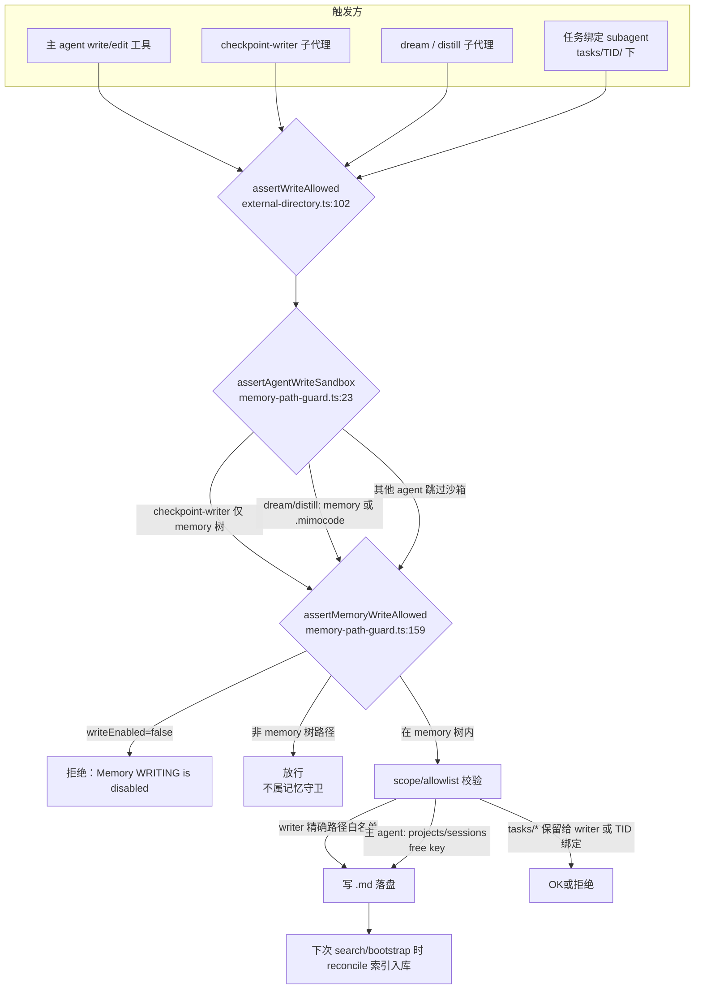

# Memory 系统现状审计（01-current-audit）

> 审计日期：2026-06（只读）
> 源码根：`D:\EchoCore\MiMo-Code\packages\cli\src`
> 参考：`echo-core/docs/echo-core-initial-audit.md`（§3 相关段落）
> 标注约定：**【事实】**= 代码写了什么；**【推论】**= 从事实推导的含义。均附 `path:line`。

---

## A. 模块清单

| 文件 | 行数 | 导出符号 | 一句话职责 |
|------|------|----------|------------|
| `memory/service.ts` | 148 | `Service`, `layer`, `defaultLayer`, `Interface` | Effect 服务：`root` / `reconcile` / `search`（FTS5+BM25，相对分数地板） |
| `memory/write-gate.ts` | 33 | `isMemoryWriteEnabled`, `MemoryWriteConfig` | 唯一读取 `memory.disable_write` 的开关；默认开启写入 |
| `memory/paths.ts` | 125 | `parsePath`, `parseCcPath`, `parseCcFrontmatterType`, `buildPath`, `resolveProjectId`, `Scope`/`MemoryType`/… | 路径 ↔ locator 解析/构造；类型探测；CC frontmatter type 提取；路径穿越防护 |
| `memory/index.ts` | 1 | `Memory`（namespace re-export） | 聚合入口：`export * as Memory from "./service"` |
| `memory/reconcile.ts` | 144 | `reconcileMemory`, `walkMemoryDir`, `walkCcRoot`, `indexFromDisk` | 磁盘 `.md` ↔ SQLite 双向同步：索引新增/更新、剪除死行 |
| `memory/fts.sql.ts` | 19 | `MemoryFtsTable` | Drizzle 表定义 `memory_fts`（内容表，非 FTS 虚表本身） |
| `memory/fts-query.ts` | 38 | `buildFtsQuery` | 自由文本 → 安全的 FTS5 OR 短语 MATCH 表达式（CJK 友好） |
| `tool/memory.ts` | 77 | `MemoryTool` | 内置 `memory` 工具：仅 `operation=search`，包装搜索结果 + 空结果升级提示 |
| `tool/memory-path-guard.ts` | 248 | `assertMemoryWriteAllowed`, `assertAgentWriteSandbox` | 记忆树写路径守卫 + 系统子代理写沙箱（纯函数，不触盘） |
| `metrics/immune-memory.ts` | 65 | `ImmuneMemoryEntry`, `ImmuneMemoryStore` | Immune V1 免疫记忆 **纯类型/schema 骨架**，无实现、无调用方 |

相关但不在核心清单的支撑文件（**【事实】**）：

| 文件 | 角色 |
|------|------|
| `tool/external-directory.ts:102-141` | `assertWriteAllowed`：write/edit/apply_patch/notebook_edit 的**唯一写门**，串接 memory-path-guard |
| `session/checkpoint-paths.ts` | 标准路径：`checkpointPath` / `memoryPath` / `globalMemoryPath` / `notesPath` / `tasksDir` + `migrateProjectMemory` |
| `session/checkpoint.ts` | checkpoint-writer 触发点；写侧受 write-gate 短路（:664） |
| `session/llm.ts:84-169` | 主 agent 系统提示中的 Memory 指令注入 |
| `session/auto-dream.ts` | auto dream/distill 触发前检查 write-gate（:113, :126） |
| `project/bootstrap.ts:52` | 启动时后台 `reconcile()` 预热 FTS |
| `migration/20260515010000_memory_fts/` … `20260521020000_memory_fts_triggers/` | FTS 表/触发器演进（v6 + trigger 修正） |

---

## B. 数据模型

### B.1 SQLite：`memory_fts`（内容表）+ `memory_fts_idx`（外部内容 FTS5 虚表）

**【事实】** 表结构来自 `fts.sql.ts:3-18` 与 `migration/20260521010000_memory_fts_v6/migration.sql:6-22`：

| 列 | 类型 | 含义 |
|----|------|------|
| `id` | INTEGER PK AUTOINCREMENT | 主键；也是 FTS 外部内容的 `content_rowid` |
| `path` | TEXT UNIQUE NOT NULL | 记忆 `.md` 的绝对路径（Windows 下布局规范化见 `paths.ts:47-52`） |
| `scope` | TEXT NOT NULL | `global` \| `projects` \| `sessions` \| `cc`（`paths.ts:4`） |
| `scope_id` | TEXT DEFAULT `''` | projects→pid hash / sessions→sid / cc→slug；global 为空串 |
| `type` | TEXT NOT NULL | mimo：`memory`/`checkpoint`/`progress`/`notes`/`free`（路径模式）；cc：frontmatter `metadata.type` 或 `free`（`paths.ts:26-42`, `reconcile.ts:63-64`） |
| `body` | TEXT NOT NULL | 整个 `.md` 文件正文（FTS 索引列） |
| `fingerprint` | TEXT NOT NULL | `"<size>-<mtimeMs>"`（`reconcile.ts:57`），变更检测用 |
| `last_indexed_at` | INTEGER NOT NULL | 索引时间戳 ms |

索引：`memory_fts_scope_idx(scope, scope_id)`、`memory_fts_type_idx(type)`（`fts.sql.ts:16-17`）。

**【事实】** FTS 虚表（migration v6）：

```sql
CREATE VIRTUAL TABLE memory_fts_idx USING fts5(
  body,
  content='memory_fts',
  content_rowid='id',
  tokenize='unicode61 remove_diacritics 1'
);
```
触发器 `memory_fts_ai/ad/au` 在 INSERT/DELETE/UPDATE 时同步虚表；v6.1 修正为 external-content 必须的 `'delete'` magic command（`20260521020000_memory_fts_triggers/migration.sql:11-17`）。

**【推论】** 内容在 `memory_fts.body` 单列全文；scope/type 只做过滤用 B-tree 索引，不参与 BM25 词权重。分词器 `unicode61` 处理 CJK 为连续字形段后按 Unicode 类别切分——与 history 侧一致（initial-audit §3 标注「CJK 分词一致性待验证」）。

### B.2 文件目录结构（`paths.ts` + `checkpoint-paths.ts`）

```
<Global.Path.data>/memory/
├── global/
│   └── MEMORY.md                          # 用户级；agent 只读侧约定、无自动创建
├── projects/
│   └── <projectId=sha256(absRepo)[:12]>/
│       ├── MEMORY.md                      # 项目持久记忆（legacy memory.md 自动改名）
│       └── memory-<topic>.md              # writer spillover
└── sessions/
    └── <sessionId>/
        ├── checkpoint.md                  # v5 单文件会话检查点（writer 独占）
        ├── checkpoint-<topic>.md          # spillover
        ├── notes.md                       # 主 agent 唯一合法 scratchpad
        └── tasks/
            └── <Tn(.n)*>/
                ├── progress.md            # 任务叙事
                └── notes.md
```

可选外部根（`memory.cc_index=true` 时）：`~/.claude/projects/<slug>/memory/**/*.md` → scope=`cc`（`service.ts:40`, `reconcile.ts:27-44`）。

**【事实】** `resolveProjectId`（`paths.ts:123-124`）= `sha256(absPath).hex.slice(0,12)`。
**【事实】** `assertSafeComponent`（`paths.ts:105-112`）拒绝 `..` 段与以 `/` 开头的注入。

---

## C. 读写链路

### C.1 写入路径



**Write-gate 检查点（配置开关，与路径守卫正交）：**

| 位置 | 行为【事实】 |
|------|-------------|
| `checkpoint.ts:664` | `!isMemoryWriteEnabled` → **完全不 spawn writer**（模板 bootstrap 一并短路） |
| `auto-dream.ts:113,126` | write-off 时 `shouldAutoDream/Distill` 直接 false |
| `memory-path-guard.ts:186-194` | `writeEnabled===false` 时 memory 树内任何写被拒 |
| `prompt.ts:986` | rebuild 路径返回 `"memory-write-off"`，直接走 compaction（不再等 writer） |
| `subagent-progress-checker.ts:99` | 插件 hook 同样走 accessor |

**落盘后入库：** 写工具**不**直接写 SQLite；`reconcileMemory` 在以下时机拉盘同步：
1. `Memory.search` 前（`service.ts:61-64`，`memory_reconcile_on_search` 默认 true）
2. 实例 bootstrap 后台 fork（`bootstrap.ts:52-56`）
3. 显式 `Memory.reconcile()`（`service.ts:46-50`）

### C.2 读取路径

```
模型调用 tool "memory"
  → tool/memory.ts:27 memory.search({query, scope?, scope_id?, type?, limit?})
    → service.ts:61  可选 lazy reconcile
    → service.ts:70  buildFtsQuery(query)
         · 无可用 token → return []（不进 SQL）
         · tokens OR-join 短语（fts-query.ts:28-37）
    → service.ts:83  floorRatio = checkpoint.memory_search_score_floor ?? 0.15
    → service.ts:102-121
         SELECT snippet(memory_fts_idx,0,'<<','>>','...',32),
                bm25(memory_fts_idx)
         FROM memory_fts_idx JOIN memory_fts ON id = rowid
         WHERE memory_fts_idx MATCH ? AND scope/type 过滤
         ORDER BY score LIMIT min(limit*3, 50)
    → service.ts:124-137
         score 取负（bm25 低分=更好 → 高分=更好）
         过滤：保留 top1 + score >= topScore * floorRatio
         slice(0, limit)  // 默认 limit=10
  → tool/memory.ts:54-73 格式化输出（snippet + path + score）
```

**【推论】** 搜索结果只有 path/snippet/score/scope/type——**无结构化实体、无边、无来源链**。完整正文需模型再 `read` path。

### C.3 Rebuild / reconcile 路径

| 类型 | 触发 | 机制 |
|------|------|------|
| **FTS reconcile**（索引同步） | bootstrap 后台；每次 search 默认；手动 | `reconcileMemory`：先并集 walk mimo+cc，再 prune 死行、index 变更文件（fingerprint `size-mtime` 短路，`reconcile.ts:56-58`） |
| **Checkpoint rebuild**（上下文重建） | prune 阈值 / overflow | `tryStartCheckpointWriter` → spawn checkpoint-writer → 写 checkpoint.md/MEMORY.md/tasks → 后续 `rebuildFromCheckpoint` 注入上下文；write-off 时短路 compaction（`prompt.ts:986`） |

**【事实】** FTS reconcile 对 CC 根未启用时，只以 mimo walk 为 prune 基准，避免跨根误删（`reconcile.ts:97-99` 注释 + 实现）。

---

## D. 能力分级

| 能力 | 分级 | 代码依据 |
|------|------|----------|
| 文件持久记忆（MEMORY.md） | ✅已实现 | 路径 `checkpoint-paths.ts:29-38`；writer 写入 `checkpoint.ts:620+`；主 agent 可编辑规则区 `llm.ts:113-123`；legacy 改名 `migrateProjectMemory` `checkpoint-paths.ts:48-60` |
| SQLite FTS5 全文检索 | ✅已实现 | migration 虚表 + `service.ts:102-121` MATCH 查询 |
| BM25 排序 | ✅已实现 | `bm25(memory_fts_idx)` `service.ts:105`，相对地板 `service.ts:135-137` |
| 写入门禁（write-gate） | ✅已实现 | `write-gate.ts:31-33`；接入 checkpoint/auto-dream/path-guard/prompt-rebuild/subagent-progress-checker |
| 路径守卫（path-guard） | ✅已实现 | `assertMemoryWriteAllowed` + `assertAgentWriteSandbox`；经 `assertWriteAllowed` 唯一写门 `external-directory.ts:102-141` |
| 自动 checkpoint 写入 | ✅已实现 | `checkpoint.ts` writer 链 + 模板/预算/校验重试（`checkpoint-retry.ts:75` 默认 budgets） |
| auto-dream 写入 | ✅已实现（自动触发门控） | 触发谓词 `auto-dream.ts:110-121`；写入本身经同一 write gate + dream 沙箱；`dream.auto` 默认 false |
| reconcile（记忆文件同步） | ✅已实现 | `reconcile.ts:94-143`；bootstrap + search 触发 |
| 记忆禁用配置 | ✅已实现 | `config.ts:337-339` `memory.disable_write`；测试 `memory-disable-write.test.ts` |
| 遗忘/过期机制 | ❌尚不存在 | 无 TTL/衰减/删除策略；`task_archive_days` 是任务归档非记忆（`config.ts:320`）；**【推论】** 记忆只增不删（除文件消失时 prune FTS 行） |
| 冲突检测与合并 | ❌尚不存在 | 无多写者版本戳/合并逻辑；路径守卫只做 allowlist，不做内容 merge；`onConflictDoUpdate` 按 path 覆盖（`reconcile.ts:78-88`）是索引 upsert 非语义合并 |
| 经验抽象/规则提取 | ⚠️依赖模型自律 | 规则区靠 prompt 约定主 agent 写入 `llm.ts:116-118`；distill 子代理可自动产出但默认关；**无**结构化抽取管线 |
| 关联图谱 | ❌尚不存在 | 无 graph/edge 表；搜索返回扁平行 |
| 来源追溯 | 🔶仅有骨架（部分） | 文件路径可定位到 scope/key；**无**「谁在何时从哪次对话提炼」元数据；Immune V1 的 `verification_evidence` 是类型设计未接线（见 §F） |
| 版本管理 | ❌尚不存在 | 仅 fingerprint 做增量索引；文件无历史版本；CHECKPOINT 是覆盖写 |

---

## E. 已知限制（硬编码 / 默认值）

**【事实】** 全部来自代码：

| 项 | 值 | 位置 |
|----|-----|------|
| search 默认 limit | 10 | `service.ts:66`；工具 schema `tool/memory.ts:15` |
| over-fetch | `min(limit*3, 50)` | `service.ts:116` |
| BM25 相对地板默认 | 0.15（0=关闭） | `service.ts:83`；config `config.ts:329-331` |
| snippet 词窗 | 32 tokens，标记 `<<`/`>>`/`...` | `service.ts:104` |
| MATCH 组合 | OR-join（非 AND） | `fts-query.ts:37`；注释解释召回率权衡 :15-22 |
| FTS 仅 body 列 | path/scope/type 不参与全文 | migration `fts5(body, content='memory_fts'…)` |
| fingerprint 精度 | size + mtimeMs，无内容 hash | `reconcile.ts:57`；**【推论】** 同 size+mtime 碰撞会漏更 |
| rebuild token 预算（push_caps 默认） | global=6K, project memory=10K, checkpoint=11K, notes=6K, memory_titles=500 … | `config.ts:286-314` |
| writer 预算校验默认 | checkpoint 11K / memory 10K / progress_per_task 6K | `checkpoint-retry.ts:75` |
| MEMORY.md 章节预算合计 | ~10K | `checkpoint-templates.ts:103` |
| write 默认 | **启用**（仅字面 `true` 关闭） | `write-gate.ts:24-29` |
| memory 工具操作 | 仅 `search`（无 write/delete） | `tool/memory.ts:10` |
| cc_index 默认 | false；开启后所有 agent 可搜 CC 个人记忆 | `config.ts:341-343`（含 prompt-injection 风险描述） |
| bash 不经 path-guard | prompt 层纪律，非工具强制 | `memory-path-guard.ts:18-21` 注释 |
| CC frontmatter type 解析 | 任意缩进 `type:` 行，非严格 metadata 子树 | `paths.ts:88-93` 自认 limitation |
| auto dream/distill spawn 间隔 | 进程内 `MIN_SPAWN_GAP_MS`（10s 量级，测试注释） | `auto-dream.ts` + 测试 `auto-dream-memory-write.test.ts:47-49` |
| 无 per-file 大小上限 | 索引整文件 body | `reconcile.ts:60`；**【推论】** 超大 md 直接入库无截断 |

**【推论】** 检索质量高度依赖 BM25 + 相对地板；OR-join 在小语料下噪声更大，靠 floor 与模型侧「升级检索提示」（`tool/memory.ts:34-50`）兜底。

---

## F. 与 Immune V1 的边界

**【事实】** `metrics/immune-memory.ts` 全文 65 行：

1. 定义 `ImmuneMemoryEntry` Zod schema：异常签名（error_category/name/tool/stage/message_pattern）、已验证根因、有效处理、验证证据数组、适用范围、confidence 三态（verified/probable/unverified）、时间戳、关联测试。
2. 定义接口 `ImmuneMemoryStore`（add/find/updateConfidence/getVerified）。
3. 文件头注释明确：「V1 只定义结构，不建设完整自主学习系统」「未经验证的模型推测不得直接成为正式经验」。

**【事实】** 全仓 `packages/` 检索：`ImmuneMemoryEntry`/`ImmuneMemoryStore` **零引用**——无 import、无 SQLite 表、无与 `Memory.Service` 的桥接。

**【事实】** 与 Memory 系统的关系：**并列概念、零耦合**。
- Memory 系统 = 通用会话/项目持久记忆（文件 + FTS 检索）。
- Immune Memory = 异常处理经验的**领域 schema 草案**，意图上类似「经验证的 runbook」，设计上要求 verification evidence 与 confidence 升降，**尚未**落入任何存储或检索路径。

**【推论】** 若未来要接线，最自然落点是：落盘为 memory 树内 `reference`/`free` 类型 `.md`（可立刻被 FTS 搜到），或新建结构化表 + 复用 write-gate/path-guard/配置开关；当前审计应将其视为 **❌ 未实现的能力意图**，不能计入 Memory 功能面。

---

## G. 调用方与集成点（Grep 摘要）

| 符号 | 主要消费点 |
|------|------------|
| `Memory.Service` | `session/llm.ts:286,297`（提示注入/层依赖）、`session/checkpoint.ts:623-629`、`project/bootstrap.ts:52`、`tool/memory.ts:21` |
| `memory.search` / MemoryTool | `tool/memory.ts:27`；注册 `tool/registry.ts:10,164` |
| `memory_fts` / fts5 | `service.ts` 查询；migration 目录；`test/memory/fts-rowid-stability.test.ts` 复刻 DDL |
| checkpoint ↔ memory | `checkpoint.ts:664` write-gate；`checkpoint-paths.ts` 路径；`checkpoint-retry.ts` 预算；`plugin/checkpoint-splitover.ts` |
| rebuild / reconcile | `service.ts:46-64`；`bootstrap.ts:52`；`prompt.ts:986` write-off 分支 |
| `isMemoryWriteEnabled` | `prompt.ts:986`、`checkpoint.ts:664`、`auto-dream.ts:113,126`、`external-directory.ts:88`、`subagent-progress-checker.ts:99` |

---

## H. 测试覆盖快扫

| 测试文件 | 覆盖点 |
|----------|--------|
| `test/tool/memory.test.ts` | search 有结果 / 无结果文案 |
| `test/tool/memory-write-gate.test.ts` | write-gate 单元行为 |
| `test/tool/memory-path-guard.test.ts` | 路径 allowlist / 保留路径 |
| `test/tool/memory-edit-ask-skip.test.ts` | 记忆树跳过 edit ask |
| `test/config/memory-disable-write.test.ts` | schema + accessor 全真值表（含非字面 true 防护） |
| `test/session/checkpoint-memory-write.test.ts` | write-off ⇒ 不 spawn writer（断言 spawn 计数） |
| `test/session/auto-dream-memory-write.test.ts` | write-off ⇒ 不触发 auto dream（DISABLED 方向） |
| `test/memory/*` | service/reconcile/paths/fts-query/fts-rowid-stability/cc-* 等底层套件 |

**【推论】** 门禁与 disable-write 测试较扎实；对 BM25 排序质量、跨 session 合并、超大文件、CJK 实战召回等偏行为/语料向的覆盖从文件名看较薄（需后续专项验证）。

---

## I. 与 initial-audit 的对照

`echo-core-initial-audit.md` 将记忆系统标为「成熟中带待验证」，并点名 history FTS 初始化/CJK 一致性待验证（:166）。本次审计补充确认：

- Memory FTS5 链路在本仓是**可运行的完整实现**（非骨架），但能力边界止于「路径化 Markdown + 全文检索」。
- 写侧治理（write-gate + path-guard + writer 独占 + spillover）已产品化。
- 学习闭环（遗忘、冲突合并、图谱、来源、经验结构化、Immune 经验库）**整体缺席**——与 initial-audit 对「失败不进认知」的批评同向。

---

*本报告只读生成，未修改任何源码。*
