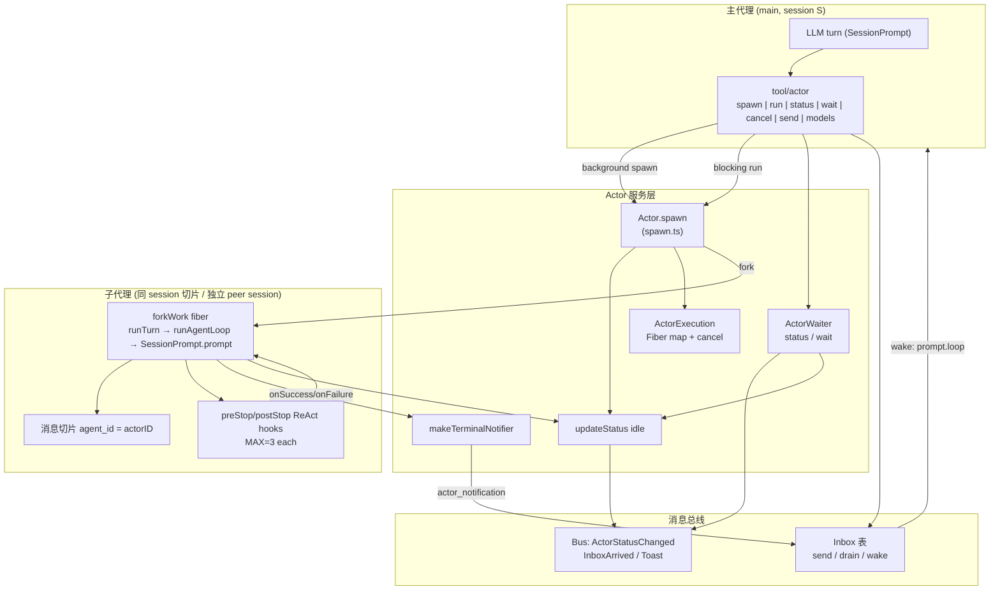

# 架构审计 03：Agent/Subagent 调度与模型运行时能力

> 源码根：`D:\EchoCore\MiMo-Code\packages\cli\src\`  
> 审计模式：只读深度审计（未修改任何源码）  
> 证据等级：**A** = 直接可执行源码路径与逻辑；**B** = 注释/类型/配置契约；**C** = 推断（相邻机制）。

---

## 1. Agent/Subagent 调度机制

### 1.1 调度关系图



### 1.2 子代理如何 spawn？

**入口**：`tool/actor.ts` 的 `ActorTool`，通过 discriminated union `operation.action` 提供 7 种动作：

| action | 语义 | 关键证据 |
|--------|------|----------|
| `spawn` | **默认**：后台启动，立即返回 `actor_id` | `tool/actor.ts:131-159, 460, 521-528` |
| `run` | 阻塞至完成，内联返回结果（描述为 RARE EXCEPTION） | `tool/actor.ts:100-129, 531-588` |
| `status` | 查询快照 | `tool/actor.ts:318-341` |
| `wait` | 等待 terminal，默认 10 分钟超时 | `tool/actor.ts:166-170, 343-360`；`actor/waiter.ts:47,152-209` |
| `cancel` | 优雅取消 | `tool/actor.ts:362-399` → `Actor.cancel` |
| `send` | 向任意 actor 投递消息 | `tool/actor.ts:274-316` → `Inbox.send` |
| `models` | 枚举可用模型（含 vision 过滤） | `tool/actor.ts:401-417` |

**调用链（v6 统一路径）**：

1. 校验 `subagent_type` 来自动态 `z.enum`（仅 `mode==="subagent" && !hidden` 的 agent）— `tool/actor.ts:78-84`
2. **禁止嵌套委派**：子代理调用 `actor` 除 `send` 外一律失败；且 `ToolRegistry.available` 对 subagent **mask 掉 `actor` 工具**（双保险）— `tool/actor.ts:235-248, 430-438`；`tool/registry.ts:387-399`
3. 权限：`ctx.ask({ permission: "actor", ... })`（除非 `bypassAgentCheck`）— `tool/actor.ts:439-447`
4. 解析模型：`op.model` → `provider.resolveModelRef`，否则 agent 配置，否则父消息模型 — `tool/actor.ts:465-473`
5. `Actor.spawn({ mode:"subagent", sessionID: ctx.sessionID, background, context:"none", tools, model, ... })` — `tool/actor.ts:499-519`
6. `spawnSubagent`：`allocateActorID` → `executions.reserve` → `actorReg.register` → `forkWork` — `actor/spawn.ts:754-818`

**ID 分配**：`{agentType}-{n}` 递增 — `actor/registry.ts:453-475`。

**两种 spawn 形态**（`Actor.spawn` 分支）：
- `mode:"subagent"` → 共享父 `sessionID`，actor 独占消息切片（`agent_id`）
- `mode:"peer"` → `session.create` 独立子 session（`session_id === actor_id`），可绑定 `cwd`/worktree 做目录隔离 — `actor/spawn.ts:682-752, 820-823`

### 1.3 上下文如何隔离 / 共享？

| 维度 | 行为 | 证据 |
|------|------|------|
| **消息切片隔离** | 子代理写入同一 session，但 `agentID=actorID`；`messages({agentID})` 默认 main 切片 | `session/session.ts:486-499`；`actor/spawn.ts:315-325` |
| **contextMode** | `none` \| `state` \| `full`；actor 工具 **固定传 `"none"`** | `actor/schema.ts:13`；`tool/actor.ts:506` |
| **full 上下文** | peer spawn 可 `contextFrom` 复制父消息前缀 + `watermark`；fork 用 `ForkContext.inheritedMessages` 快照 | `actor/spawn.ts:694-699, 757`；`ForkContext` `actor/spawn.ts:59-95` |
| **工具白名单** | `tools: next.toolAllowlist ?? "INHERIT"`；`Permission.disabled` 运行时剥离 write 等 | `tool/actor.ts:507`；`actor/spawn.ts:421-422`；`session/llm.ts:1039-1053` |
| **系统提示** | 子代理用自己的 `agent.prompt`；memory/checkpoint 指令仅 main/peer（`servesCheckpoint`） | `session/llm.ts:318-365`；`actor/registry.ts:437-451` |
| **返回格式注入** | lifecycle-managed subagent 自动追加 `**Status**/**Summary**` 模板 | `actor/spawn.ts:38-57, 786-795` |
| **目录隔离** | peer 的 `cwd` → `InstanceRef` 绑定 worktree | `actor/spawn.ts:688-692, 677` |

**结论**：子代理上下文**默认隔离**（`context: none` + 消息切片），**不自动继承父对话**；peer 模式可显式 `full`/`contextFrom` 共享前缀。

### 1.4 完成后如何通知主代理？

1. **终态通知**：`forkWork` 的 `onSuccess`/`onFailure` → `notify("completed"|"failed"|"cancelled")` → `makeTerminalNotifier` → `Inbox.send`（`type:"actor_notification"`）投递到父 session 的 `main`（或 `parentActorID`）— `actor/spawn.ts:625-668`；`actor/notification.ts:32-59`
2. **仅 background actor 会发通知**（`!actor.background` 直接 return）— `actor/notification.ts:35`
3. **系统 agent 豁免**：checkpoint-writer 等不发通知 — `actor/notification.ts:36-37`
4. **唤醒**：`Inbox.send` 默认 fork `sessionPrompt.loop` 自动 wake 接收方（`wake:false` 可抑制）— `inbox/inbox.ts:190-227`
5. **UI Toast**：`TuiEvent.ToastShow` — `actor/notification.ts:62-67`
6. **阻塞 run 路径**：不依赖 inbox，直接 `Deferred.await(spawnResult.outcome)` — `tool/actor.ts:539-552`
7. **wait 路径**：订阅 `Bus` 的 `ActorStatusChanged`，在 `isWaitResolving` 时 resolve — `actor/waiter.ts:166-208`
8. **结果落库**：最终文本/structured 写入最后一条 assistant 消息的 `actorResult` 字段 — `actor/spawn.ts:601-622`

### 1.5 并行 / 取消 / 超时 / 数据传递

| 能力 | 支持？ | 细节与证据 |
|------|--------|------------|
| **并行** | **已实现** | 多次 `spawn` 各自 `fork` 独立 Effect Fiber；`ActorExecution` 以 `sessionID:actorID` 为 key 并发 map；`cancel` 子树 `concurrency:"unbounded"` — `actor/spawn.ts:837-841`；`actor/execution.ts:41-112` |
| **取消/中断** | **已实现** | `cancel` → `requestCancel` + `state.cancelActor` + `Fiber.interrupt`；级联取消子孙；`run` 时挂 `ctx.abort` → graceful cancel；`execution.cancelled` 在 turn 循环检查 `Effect.interrupt` — `actor/spawn.ts:825-870, 536-552, 428`；`actor/execution.ts:114-122` |
| **超时** | **已实现** | `run`：`Effect.timeout(timeout_ms ?? 600_000)` → `{status:"timeout"}`；`wait`：默认 600s → `{status:"timeout"}` — `tool/actor.ts:545-546`；`actor/waiter.ts:47,196-203` |
| **僵尸回收** | **已实现** | `sweepAbandonedZombies`（bootstrap）；`deriveLiveness` stall 6min / abandon 10min — `actor/registry.ts:31-53`；`actor/schema.ts:112-190`；`project/bootstrap.ts:29-35` |
| **数据传递** | **已实现** | ① spawn 返回 `actor_id`；② `wait`/`status` 快照含 result/structured；③ 终态 inbox 通知正文；④ 阻塞 run 的 `<actor_result>`；⑤ `send` 文本消息；⑥ `output_schema` 强制 structured 返回 — `tool/actor.ts:123-128, 516-518, 579-587`；`actor/waiter.ts:121-149` |
| **结构化输出** | **已实现** | `format:{type:"json_schema", schema, retryCount:2}` → 注入 `StructuredOutput` 工具 + `toolChoice:"required"` + 自动重试 — `actor/spawn.ts:225-232`；`session/prompt.ts:5042-5064, 4341-4384` |
| **task 绑定** | **已实现** | spawn 自动 `taskRegistry.start`；postStop 校验 `tasks/<id>/progress.md`（插件钩子）— `actor/spawn.ts:380-384`；`tool/actor.ts:121` |

**证据等级**：本节均为 **A**（直接源码）。

---

## 2. 模型供应商与 Provider 抽象

### 2.1 Provider 接口

核心接口 `Provider.Interface`（`provider/provider.ts:1092-1106`）：

```typescript
interface Interface {
  prepareRefresh(config: Config.Info): Effect<() => void>
  list(): Effect<Record<ProviderID, Info>>
  getProvider(providerID): Effect<Info>
  getModel(providerID, modelID): Effect<Model>
  getLanguage(model): Effect<LanguageModelV3>   // AI SDK LanguageModelV3
  closest(providerID, query[]): Effect<...>
  getSmallModel(providerID): Effect<Model | undefined>
  getVisionModel(providerID?): Effect<Model | undefined>
  resolveModelRef(ref, contextProviderID?): Effect<Model>
  defaultModel(): Effect<{ providerID, modelID }>
}
```

- Effect `Context.Service`：`"@opencode/Provider"` — `provider/provider.ts:1116`
- 模型实例缓存：`Map<"provider/id", LanguageModelV3>` — `provider/provider.ts:1825-1840`

### 2.2 支持的供应商（BUNDLED_PROVIDERS）

懒加载 AI SDK 工厂（`provider/provider.ts:237-262`），**A 级**：

| 类别 | npm 包 |
|------|--------|
| 云大厂 | anthropic, azure, google, google-vertex(+anthropic), amazon-bedrock, openai |
| 兼容/聚合 | openai-compatible, openrouter, gateway, github-copilot（本地 SDK）, gitlab-ai-provider, venice |
| 其他 | xai, mistral, groq, deepinfra, cerebras, cohere, togetherai, perplexity, vercel, alibaba |

另有：
- **MiMo 系模型强制 pin 到 `@ai-sdk/openai-compatible`** — `provider/provider.ts:1151-1160`
- **自定义 provider**：`config.provider` 可注入 npm/api/options/apiKey/baseURL/timeout 等 — `config/provider.ts:78-100`；`config/config.ts:203-204`
- **模型目录**：models.dev / `models-catalog*` + 插件 `discoverModels`；启用/禁用 `enabled_providers` / `disabled_providers` — `config/config.ts:138-142`
- **GPT-5+ 走 Responses API** 分支 — `provider/provider.ts:52-56`；copilot SDK 子树 `provider/sdk/copilot/**`

**证据等级**：**A**。

### 2.3 模型调用失败如何处理 / 重试策略

**调用入口**：`session/llm.ts` 的 `stream()` → AI SDK `streamText`（`llm.ts:695+`），外层包：

1. **请求阶段 ladder**：`SessionRetry.decide(normalized, "request", scope)` → 若 retryable 则 `Effect.fail` 进入外层重试 — `llm.ts:941-964`
2. **错误归一化**：`MessageV2.fromError` / `fromLiveError` → NamedError（APIError / ContextOverflow / Auth / Aborted…）— `spawn.ts:117-118`；`llm.ts:951`
3. **终态分类**：`FailureKind = transient|overflow|auth|aborted|other`，供父代理消费 — `actor/spawn.ts:120-173`

**重试决策核心 `SessionRetry.decide`**（`session/retry.ts:323-428`）：

| 类别 | 可重试？ | 说明 |
|------|----------|------|
| ContextOverflow / Aborted / Auth / AbortError | **否** | terminal 不变量，host 不可覆盖 — `retry.ts:332-356` |
| 401 / 402 / 501 / 505 / 404* / 配额/订阅耗尽 | **否** | `*` 404 默认 terminal 除非 `allow404Retry` — `retry.ts:391-398` |
| network | **是** | persistent 指数退避 — `retry.ts:401,190` |
| rate_limit (429 / 文案) | **是** | 尊重 `Retry-After` / 正文 hint — `retry.ts:287-314, 402-410` |
| server (5xx / overloaded) | **是** | persistent / bounded 按 host class — `retry.ts:411-415` |
| stream / unknown / host retryable | **是** | bounded 预算（unknown 默认 8 次 / 15min）— `retry.ts:416-426, 60-124` |
| 安全终端 / host terminal | **否** | `isSafetyTerminal` / `hostRetryClass` — `retry.ts:386-390` |

**预算体系**（可被 `config.retry` 与 `provider[id].retry` 覆盖）— `retry.ts:167-181`；`config/config.ts:207`：

| scope | 默认 maxRetries | maxElapsed | initial | 备注 |
|-------|-----------------|------------|---------|------|
| request | 4 | 30s | 200ms | `REQUEST_*` — `retry.ts:18-21` |
| stream | 5 | 10min | 2s | `STREAM_*` |
| network | persistent | 0 (无界) | 5s → max 60s | 强制 persistent |
| rate_limit | persistent | 0 | 2s → max 5min | |
| server | persistent | 0 | 2s → max 30s | |
| unknown | 8 | 15min | 2s | 未分类 ≠ 终端 |
| max-candidate / max-judge | 3 | 3min | 500ms | max-mode 专用 |

**指数退避 + jitter**：`retryDelay = initial * 2^(n-1)`，jitter 0.1 — `retry.ts:434-446`。

**SSE/传输层超时**（与重试正交）：
- 默认 header 超时 300s；**chunk 超时 480s**（可 per-provider `chunkTimeout`）— `provider/provider.ts:44-50`
- `wrapSSE` / `timeoutController` / `trackAbortSource` — `provider/provider.ts:58-231`

**注意**：任务描述中的 `isTimeoutError` / `isPermissionDenied` **未在 `session/retry.ts` 出现**；超时/权限语义由 `decide` 中的 AbortError/AuthError/APIError statusCode 分支承担 — **A 级否定证据**（全文已读 551 行）。

### 2.4 上下文窗口管理

| 机制 | 实现 | 证据 |
|------|------|------|
| 窗口解析 | `contextWindow()`：hard = `limit.input \|\| limit.context`；usable 扣 reserved；trigger ≈ 90% | `session/overflow.ts:80-106` |
| 默认窗口 | `DEFAULT_CONTEXT_WINDOW = 1_000_000` | `provider/provider.ts:35` |
| 溢出判定 | `isOverflow`：provider tokens 合计 vs trigger；`compaction.auto===false` 关闭 | `session/overflow.ts:99-105` |
| 压力等级 | `pressureLevel` / `contextPressureLevel` | `session/overflow.ts:108-127` |
| **Prune** | 回退保护尾部 `PRUNE_PROTECT=40k`，最小裁剪 `PRUNE_MINIMUM=20k`；大工具结果 shrink 至 `COMPACTION_TOOL_RESULT_LIMIT=8k` | `session/compaction.ts:40-44, 159-174, 286-333` |
| **Compaction** | summary 消息 + tail budget 40k；触发 token 可配置 `compaction.max_context` / reserved | `config/config.ts:250-257`；`compaction.ts:182-215` |
| Token 估算 | `Token.estimate = len/4`（字符启发式） | `util/token.ts:1-5` **A** |
| 真实用量 | 响应 `tokens` 字段（input/output/cache.read/write）参与 overflow | `overflow.ts:99-104` |

**证据等级**：**A**。

### 2.5 Function Calling 与工具参数校验

| 能力 | 状态 | 证据 |
|------|------|------|
| Function Calling | **已实现**（AI SDK `tool` + `streamText` tools/toolChoice） | `session/llm.ts:9, 525-527, 695-744` |
| toolChoice | `auto` \| `required` \| `none`；json_schema 时强制 `required` | `llm.ts:189, 5212`；`prompt.ts:5212, 5438` |
| 工具可见性过滤 | user.tools 开关 + `Permission.disabled` + agent toolAllowlist + GPT 工具集切换 | `llm.ts:1039-1053`；`tool/registry.ts:336-385` |
| 参数 Schema | 各工具 `zod` schema（如 actor 的 `strictObject` + `discriminatedUnion`）经 `parameters` 暴露给模型 | `tool/actor.ts:207-228` |
| 运行时参数解析 | AI SDK / 工具侧 `parseToolInput` + `asSchema(...).jsonSchema` | `llm.ts:579-580` |
| 兼容性 stub | LiteLLM/Copilot 无 tools 但有 tool 历史时注入 `_noop` | `llm.ts:544-560` |
| 未知工具 | `NoSuchToolError` import；workflow 路径显式 `Unknown tool` | `llm.ts:9, 576` |
| 子代理再委派 | **禁止**（mask + 运行时双检） | `tool/registry.ts:387-399`；`tool/actor.ts:430-438` |

**证据等级**：**A**。

### 2.6 结构化输出

| 路径 | 实现 | 证据 |
|------|------|------|
| 强制工具调用 | `format.type==="json_schema"` → 注册 `StructuredOutput` 工具，`toolChoice:"required"`，系统提示强制调用 | `prompt.ts:300, 5042-5064, 5212` |
| 校验与重试 | zod/JSON Schema 校验失败 → `autoRetryStructuredOutput`（默认 retryCount 2）→ `StructuredOutputError` | `prompt.ts:4341-4384`；`message-v2.ts:74-75` |
| 子代理透传 | spawn `output_schema` → `AgentOutcome.structured` 优先于 finalText | `actor/spawn.ts:101-104, 326-346, 517` |
| Provider 原生 | copilot chat 有 `supportsStructuredOutputs` 分支 | `provider/sdk/copilot/chat/openai-compatible-chat-language-model.ts:122-158` |

**证据等级**：**A**。

---

## 3. 上下文管理

### 3.1 分层模型

```
Instance (项目目录)
 └─ Session (SQLite SessionTable)
     ├─ main 消息切片 (agent_id = main / undefined)
     ├─ subagent 切片 (agent_id = explore-1 …)  ← 共享 session，隔离历史
     └─ peer 子 Session (parent_id → 父 session) ← 独立历史
         └─ ActorRegistry 行 (session_id, actor_id, context_mode, watermark)
```

### 3.2 关键机制

1. **消息切片**：`messages()` 默认 main；`"*"` 仅诊断 — `session/session.ts:486-499`
2. **watermark**：`full` 模式下 `lastMainMessageID` 记录 spawn 边界，fork 过滤 ownNew — `actor/spawn.ts:757, 86-93`
3. **system 组装**：`buildSystemArray` = agent base + memory 指令（仅 main/peer）+ plugin transform + skills — `session/llm.ts:299-375`
4. **checkpoint 路由**：`servesCheckpoint` 排除 subagent 与 system-spawned — `actor/registry.ts:437-451`
5. **compaction/prune**：见 §2.4
6. **prefix cache 友好**：system 合并为单段以稳定前缀 — `llm.ts:377+`
7. **ForkContext**：完整 `inheritedMessages` 快照 + `parentPermission`，供 checkpoint-writer 等 fork 复用缓存前缀 — `actor/spawn.ts:59-95`

**证据等级**：**A**。

---

## 4. 工具调用能力

### 4.1 工具注册与分发

- 统一 `Tool.define(id, Init)` + `ToolRegistry` — `tool/tool.ts`；`tool/registry.ts:144, 237`
- **GPT 工具集 vs 标准工具集**按模型/harness 切换 — `registry.ts:344-368`
- **actor 工具**是唯一子代理调度入口；`available()` 对 subagent 掩蔽 — `registry.ts:387-399`
- **exec/script gateway**：部分工具经 `exec` 聚合 — `llm.ts:1041-1052`

### 4.2 与调度相关的工具契约（actor）

| 字段 | 校验 | 证据 |
|------|------|------|
| `subagent_type` | 动态 enum，无 spawnable 时 `Effect.die` | `tool/actor.ts:78-83` |
| `timeout_ms` | 正整数 optional，默认 600000 | `tool/actor.ts:93-98` |
| `task_id` | 执行期软校验，非法则 ad-hoc 丢弃 | `tool/actor.ts:475-493` |
| `output_schema` | 任意 JSON Schema record | `tool/actor.ts:123-128` |
| 根 schema | `.meta({type:"object"})` 防部分模型 stringify | `tool/actor.ts:207-214` |

### 4.3 权限

- spawn 前 `ctx.ask("actor")` — `tool/actor.ts:439-447`
- write 权限由 `Permission.disabled(["write"], agent.permission)` 决定 `canWrite`，影响 postStop 是否 nag — `actor/spawn.ts:410-422`

**证据等级**：**A**。

---

## 5. 错误处理与重试

### 5.1 分层错误模型

```
Provider HTTP/SSE 错误
  → ProviderError.parseAPICallError / wrapSSE timeout
  → MessageV2.fromError (NamedError: APIError|ContextOverflowError|AuthError|AbortedError|Unknown)
  → SessionRetry.decide(phase, scope) → retryable? → budget + delay → 终端则上抛
  → runAgentLoop 捕获 info.error → classifyAssistantError → FailureInfo{kind,retryable,name}
  → forkWork.onFailure → AgentOutcome{status:"failure", error, failure, structured?}
  → 通知父代理 + Deferred
```

**关键点**（`actor/spawn.ts:133-137` 注释）：**到达消费者的失败已是 post-retry**；`retryable` 表示“属于可重试类”，不是“请再试”。

### 5.2 钩子 ReAct 上限

- preStop / postStop 各 `MAX_*_REACT = 3` — `actor/spawn.ts:35-37, 456-466, 537-548`
- 超限发 `HookEvent.ReActMaxReached` 并 break

### 5.3 消费者侧契约

| 路径 | 失败表现 | 证据 |
|------|----------|------|
| `actor run` | child failure → **工具执行失败**（含 partial） | `tool/actor.ts:558-561` |
| `actor wait` | 结构化 snapshot（含 error 字段） | `tool/actor.ts:351-359` |
| `actor spawn` | 仅返回 actor_id；结果走通知 | `tool/actor.ts:521-528` |
| inbox 投递失败 | `InboxReceiverNotFound` → “receiver not found” | `tool/actor.ts:292-305` |

**证据等级**：**A**。

---

## 6. Session 生命周期

### 6.1 创建

`Session.create` / `createNext`（`session/session.ts:457-465, 550-598`）：

1. 分配 descending SessionID + slug + projectID + directory
2. 可选 `parentID` / `contextFrom` / `contextWatermark` / `permission`
3. 同步 `Event.Created`
4. **自动 register main actor**（`actorID:"main", mode:"main"`）
5. 发布 `Event.Updated`（非 experimental workspaces 路径）

**Peer spawn** 再次 `session.create({ parentID, contextFrom?, directory? })` — `actor/spawn.ts:694-699`。

### 6.2 运行态

- `SessionRunState`：busy/cancel；`cancelActor` — `spawn.ts:848`；`waiter.ts:85-87`
- `promptLock`：串行化 remove 等 — `session.ts:696-698`
- Actor 状态机：`pending → running → idle(+lastOutcome)` — `actor/schema.ts:4-8`

### 6.3 销毁 / 移除

`Session.remove`（`session.ts:656-698`）：
1. 递归删除 children
2. `Event.Deleted` + 清理 parent-grant / promptLocks / hint state
3. 持锁执行

**注意**：`remove` **不显式**在本函数内 cancel actors；依赖执行层/进程退出与 `sweepAbandonedZombies`。peer 子 session 作为 children 被级联删除。

### 6.4 Bootstrap（`project/bootstrap.ts` 全文）

```text
InstanceBootstrap:
  1. Config.get()          — 急加载
  2. Plugin.init()         — 可改 config，最先
  3. sweepAbandonedZombies — 回收跨进程僵尸 actor 行
  4. forkDetach init: LSP, ShareNext, Format, File, FileWatcher, Vcs, Snapshot, WriterService
  5. Memory.reconcile (async) — FTS 预热
  6. 订阅 Command.INIT → Project.setInitialized
  7. Metrics.subscribe
```

**证据**：`project/bootstrap.ts:21-68` — **A**。

### 6.5 运行时状态归属

| 状态 | 存放 |
|------|------|
| Session/Messages/Parts | SQLite（Storage） |
| Actor 注册表 | SQLite `ActorRegistryTable` |
| Inbox | SQLite + 7 天 GC |
| 活跃 Fiber | 进程内 `ActorExecution.active` Map |
| ForkContext | 进程内 Map，terminal 时 delete |
| spawnRef / inboxServiceRef | 进程内 late-bound ref（防 layer 环）— `tool/actor.ts:47-62`；`spawn.ts:876-890` |

**证据等级**：**A**。

---

## 7. 能力矩阵

| 能力 | 状态 | 证据 |
|------|------|------|
| 子代理 spawn（后台/阻塞） | **已实现** | `tool/actor.ts:100-159, 499-528`；`spawn.ts:754-818` **A** |
| 并行多子代理 | **已实现** | 多 fiber + registry；`spawn.ts:837-841` **A** |
| 上下文隔离（切片） | **已实现** | `session.ts:486-499`；actor 固定 `context:"none"` **A** |
| 上下文共享（full/fork） | **已实现**（peer/fork 路径） | `spawn.ts:694-699, 757`；`ForkContext` **A** |
| 完成通知父代理 | **已实现**（background） | `notification.ts:32-59`；inbox wake **A** |
| 阻塞等待（wait/run） | **已实现** | `waiter.ts:152-209`；`actor.ts:539-552` **A** |
| 超时（run/wait 默认 10min） | **已实现** | `actor.ts:98, 545`；`waiter.ts:47` **A** |
| 取消/级联中断 | **已实现** | `spawn.ts:825-870`；`execution.ts:114-122` **A** |
| 消息 send/drain | **已实现** | `inbox.ts:158-408` **A** |
| 嵌套 spawn 子代理 | **不支持**（有意禁止） | `tool/actor.ts:430-438`；`registry.ts:387-399` **A** |
| 僵尸/进程重启回收 | **已实现** | `registry.ts:31-53`；`schema.ts:170-190` **A** |
| 多模型供应商 | **依赖外部Provider**（SDK 懒加载） | `provider.ts:237-262` **A** |
| Provider 抽象（LanguageModelV3） | **已实现** | `provider.ts:1092-1116` **A** |
| 自定义 provider 配置 | **已实现** | `config/provider.ts`；`config.ts:203` **A** |
| model_groups 分层（ultra/standard/lite） | **已实现** | `provider.ts:36-38, 1867-1905` **A** |
| 模型调用流式 streamText | **已实现** | `llm.ts:695` **A** |
| 分类重试（network/rate/server/unknown） | **已实现** | `retry.ts:323-428` **A** |
| Retry-After / 预算可配置 | **已实现** | `retry.ts:167-196`；`config.ts:207` **A** |
| 传输层超时（header/chunk） | **已实现** | `provider.ts:44-50, 58-231` **A** |
| 上下文窗口解析 + 溢出检测 | **已实现** | `overflow.ts:80-105` **A** |
| Prune / Compaction | **已实现** | `compaction.ts`；`config.ts:250-257` **A** |
| Token 估算（字符/4） | **已实现**（启发式，非 BPE） | `util/token.ts:1-5` **A** |
| 真实 token 账单（provider usage） | **依赖外部Provider** | `overflow.ts:99-104` **A** |
| Function Calling | **已实现** | `llm.ts:695-744` **A** |
| 工具参数 Zod 校验 | **已实现** | `tool/actor.ts:207-228` 等 **A** |
| 工具权限剥离 | **已实现** | `llm.ts:1039-1053` **A** |
| 结构化输出 json_schema | **已实现** | `prompt.ts:5042+`；`actor.ts:516-518` **A** |
| 结构化输出原生 API（全部供应商） | **依赖外部Provider** | copilot `supportsStructuredOutputs` **A/B** |
| Session create/remove | **已实现** | `session.ts:457-533, 656-698` **A** |
| Bootstrap 初始化 | **已实现** | `bootstrap.ts:21-68` **A** |
| 会话级强制 kill-switch 超时策略（全局 wall-clock） | **不支持**（仅 per-call timeout / retry budget） | 未见全局 session deadline **C** |
| `isTimeoutError` / `isPermissionDenied` 专用 API | **不支持**（未在 retry.ts 存在） | 全文 `retry.ts` **A** |

---

## 8. 审计结论摘要

1. **调度核心**是 Effect Fiber + SQLite 注册表 + Inbox 三件套：`Actor.spawn` 分配 actorID、注册、fork 工作 fiber；终态经 `ActorRegistry` + `Inbox` 回传；`ActorWaiter` 提供事件驱动 wait。  
2. **子代理与父对话默认隔离**（同 session 不同 `agent_id` 切片，`context:"none"`），**禁止再委派**，数据经 actor_id / wait / inbox / `<actor_result>` / structured 五条通道传递。  
3. **并行、取消（级联）、超时（默认 10min）、僵尸回收**均已落地，且有基于实测 p99 的 liveness 阈值。  
4. **Provider 层**是 AI SDK `LanguageModelV3` 工厂的懒加载集合 + models.dev 目录 + 可配置自定义端点；MiMo 系固定 openai-compatible。  
5. **错误处理**采用 NamedError 归一化 → `decide` 分类 → 分相位预算重试 → 落到 `FailureKind` 给父代理；**超时/权限无独立 `isTimeoutError/isPermissionDenied` API**，语义并入 decide。  
6. **上下文**靠 usage token 触发 prune/compaction；本地估算为 `len/4` 启发式，真实计数依赖 provider 返回。  
7. **结构化输出**走工具强制 + 自动重试，而非原生 response_format 一跳（部分 SDK 另有原生分支）。  
8. **Bootstrap** 职责清晰：config → plugin → actor 僵尸清扫 → 异步子系统 → memory/FTS。

---

*报告生成：只读审计；路径均相对 `packages/cli/src/`。*
