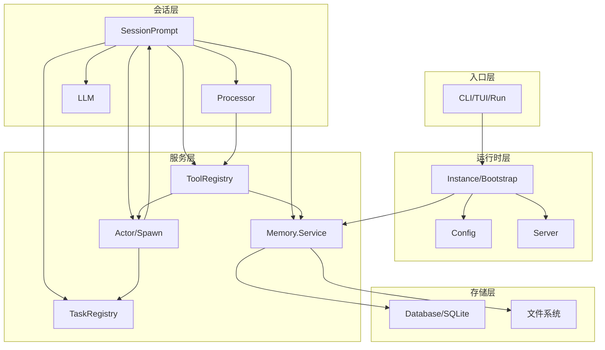
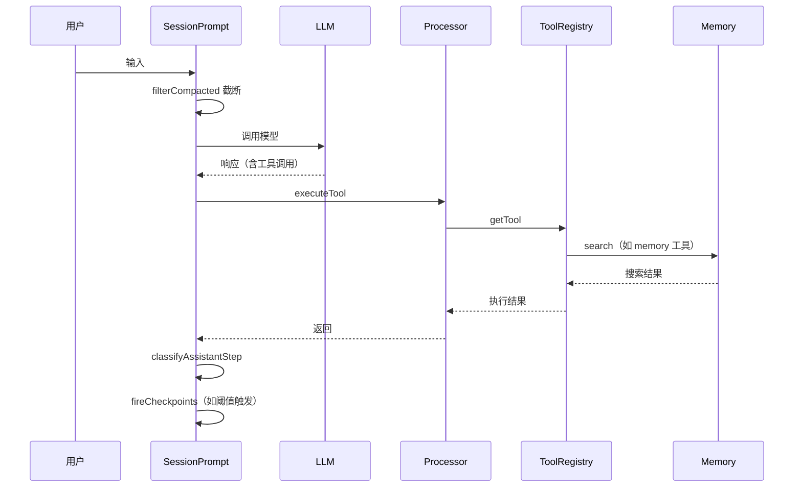
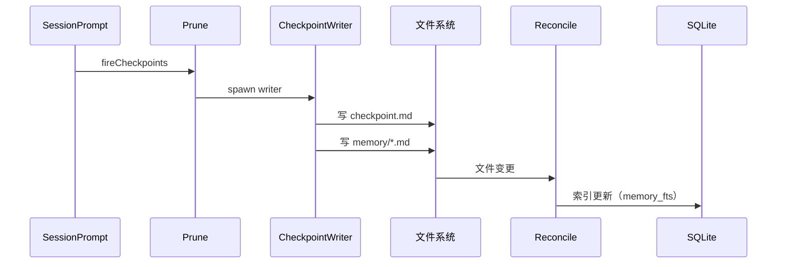
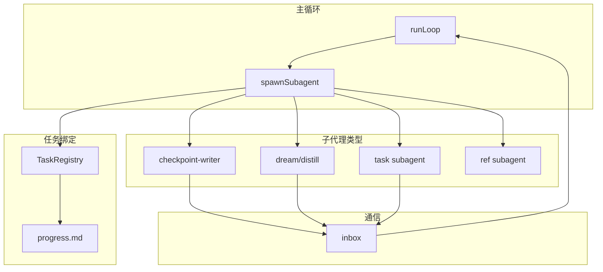

# Echo Core 身体架构第一轮尽调报告：整体结构与运行时

> 任务编号：ECC-ARCH-AUDIT-R1
> 审计日期：2026-10-31
> 审计性质：只读工程审计
> 执行范围：`D:\EchoCore\MiMo-Code\packages\cli\src\`
> 状态：✅ 完成
> 约束：未修改任何生产代码、测试、配置、Memory 数据

---

## 目录

1. [项目整体目录树](#1-项目整体目录树)
2. [技术栈及版本清单](#2-技术栈及版本清单)
3. [核心模块清单](#3-核心模块清单)
4. [模块实现状态矩阵](#4-模块实现状态矩阵)
5. [模块依赖图](#5-模块依赖图)
6. [核心运行数据流图](#6-核心运行数据流图)
7. [Agent/Subagent 调度图](#7-agentsubagent-调度图)
8. [启动与运行生命周期](#8-启动与运行生命周期)
9. [模型与运行时能力清单](#9-模型与运行时能力清单)
10. [Memory 上下游连接关系](#10-memory-上下游连接关系)
11. [当前架构问题清单](#11-当前架构问题清单)
12. [未能确认的信息](#12-未能确认的信息)
13. [关键证据索引](#13-关键证据索引)
14. [审计范围与未执行事项](#14-审计范围与未执行事项)

---

## 1. 项目整体目录树

### 1.1 项目根结构

```
D:\EchoCore\MiMo-Code\
├── packages/
│   ├── cli/                    # 核心应用（主包）
│   ├── shared/                 # 共享工具
│   ├── plugin/                 # 插件系统
│   └── sdk/                    # SDK
├── package.json                # 根配置（workspaces）
├── bun.lock                    # Bun 锁文件
├── bunfig.toml                 # Bun 配置
├── tsconfig.json               # TypeScript 配置
├── AGENTS.md                   # Agent 指令
├── CONTRIBUTING.md             # 贡献指南
└── USE_RESTRICTIONS.md         # 使用限制
```

### 1.2 核心应用目录（packages/cli/src/）

```
packages/cli/src/
├── index.ts                    # CLI 入口
├── cli/                        # 命令层
│   ├── bootstrap.ts            # 统一 bootstrap 壳
│   ├── cmd/
│   │   ├── serve.ts            # 服务器模式
│   │   ├── tui.ts              # TUI 模式（默认）
│   │   └── run.ts              # Headless 模式
│   └── tui/                    # TUI 组件
├── project/
│   ├── bootstrap.ts            # Instance 初始化
│   └── instance.ts             # Instance 管理
├── effect/                     # Effect 运行时
├── config/                     # 配置加载
│   └── config.ts               # 多层配置合并
├── storage/                    # 存储层
│   └── database.ts             # SQLite 管理
├── server/                     # HTTP 服务器
├── session/                    # 会话管理
│   ├── prompt.ts               # 主循环（~7248 行）
│   ├── processor.ts            # 工具执行
│   ├── llm.ts                  # LLM 调用
│   ├── retry.ts                # 重试策略
│   ├── checkpoint.ts           # 检查点
│   ├── message-v2.ts           # 消息处理
│   ├── prune.ts                # 上下文裁剪
│   ├── classify.ts             # 步骤分类
│   ├── auto-dream.ts           # Auto Dream 触发
│   └── goal.ts                 # Goal 判官
├── tool/                       # 工具系统
│   ├── registry.ts             # 工具注册
│   ├── memory.ts               # Memory 工具
│   ├── memory-path-guard.ts    # 路径守卫
│   ├── actor.ts                # 子代理工具
│   ├── external-directory.ts   # 写入门控
│   └── [其他内置工具].ts
├── memory/                     # Memory 系统
│   ├── service.ts              # 核心服务
│   ├── paths.ts                # 路径解析
│   ├── reconcile.ts            # 索引同步
│   ├── write-gate.ts           # 写入门禁
│   └── fts.sql.ts              # FTS 定义
├── actor/                      # 子代理系统
│   ├── spawn.ts                # 子代理生成
│   ├── registry.ts             # 代理注册
│   └── inbox.ts                # 消息收件箱
├── task/                       # 任务系统
│   ├── registry.ts             # 任务注册
│   └── schema.ts               # 任务 Schema
├── provider/                   # 模型 Provider
├── permission/                 # 权限系统
├── plugin/                     # 插件系统
├── metrics/                    # 指标系统
│   ├── classify.ts             # 错误分类
│   └── immune-memory.ts        # Immune 类型（仅接口）
├── skill/                      # 技能系统
├── agent/                      # Agent 定义
├── workflow/                   # 工作流
├── snapshot/                   # 快照
└── vcs/                        # 版本控制
```

**证据等级**：VERIFIED（目录结构来自实际文件系统）

---

## 2. 技术栈及版本清单

| 技术 | 版本 | 用途 | 证据 |
|------|------|------|------|
| TypeScript | ~5.x | 主语言 | `tsconfig.json` |
| Bun | 1.3.14 | 运行时/包管理 | `package.json:packageManager` |
| Effect | 4 beta | 函数式运行时 | `packages/cli/package.json` |
| Hono | - | HTTP 框架 | `server/` 目录 |
| Drizzle ORM | - | 数据库 ORM | `storage/` 目录 |
| SQLite | - | 数据库 | `node:sqlite` |
| SolidJS | - | TUI 框架 | `cli/tui/` |
| OpenTUI | - | 终端 UI | `cli/tui/` |
| Vercel AI SDK | - | LLM 调用 | `provider/` |
| Zod | - | Schema 校验 | 多处 |

**证据等级**：VERIFIED（来自 package.json 和 import 语句）

---

## 3. 核心模块清单

| # | 模块 | 代码位置 | 核心职责 |
|---|------|---------|---------|
| 1 | Context/Prompt | `session/prompt.ts` | 主循环、上下文管理、溢出处理 |
| 2 | Planning/Task | `task/registry.ts` | 任务树状态机 |
| 3 | Execution/Tool | `tool/registry.ts` + `session/processor.ts` | 工具注册与执行 |
| 4 | Reflection | `session/auto-dream.ts` + dream/distill agent | 定时触发反思（prompt 约定） |
| 5 | Recovery | `session/retry.ts` + `checkpoint-retry.ts` | 错误分类与重试 |
| 6 | Immune | `metrics/classify.ts` | 错误分类（记忆层仅接口） |
| 7 | Skills | `skill/index.ts` | 技能服务与注入 |
| 8 | Agent/Subagent | `actor/spawn.ts` | 子代理调度 |
| 9 | Memory | `memory/service.ts` | 记忆检索与索引 |
| 10 | Session/Runtime | `project/bootstrap.ts` | Instance 初始化 |

**证据等级**：VERIFIED（来自代码目录和关键文件）

---

## 4. 模块实现状态矩阵

| 模块 | 状态 | 关键证据 |
|------|------|---------|
| Context/Prompt | **VERIFIED** | `runLoop` at `prompt.ts:3625`；filterCompacted at `message-v2.ts:1452` |
| Planning/Task | **VERIFIED** | TaskRegistry at `task/registry.ts`；树形状态机完整 |
| Execution/Tool | **VERIFIED** | `executeTool` at `processor.ts:451`；注册在 `registry.ts` |
| Reflection | **PARTIAL** | `auto-dream.ts` 仅触发器；行为靠 prompt + 隐藏 agent |
| Recovery | **PARTIAL** | `SessionRetry.decide` at `retry.ts:323`；无总控 |
| Immune | **PARTIAL** | `classifyToolError` at `classify.ts:12` 已落地；ImmuneMemoryStore 仅接口 |
| Skills | **VERIFIED** | `skill/index.ts:98` 完整服务 + 工具注入 |
| Agent/Subagent | **VERIFIED** | `spawnSubagent` at `spawn.ts:754`；forkWork 完整 |
| Memory | **PARTIAL** | `service.ts` 有 search/reconcile；无写 API；无遗忘/冲突/图谱 |
| Session/Runtime | **PARTIAL** | `InstanceBootstrap` at `bootstrap.ts`；Database.close 未接线 |

**证据等级**：VERIFIED（来自代码路径和行号）

---

## 5. 模块依赖图

### 5.1 整体模块依赖（Effect Layer 装配视角）



**关键发现**：
- Memory 是**干净叶子服务**（不依赖 Session/Actor/Tool）
- 环全部在 Actor/SessionPrompt/ToolRegistry/Checkpoint 之间
- `Memory.Service` 只有 `root/reconcile/search`，**无写 API**（`service.ts:19-31`）

**证据等级**：VERIFIED（来自 import 分析和调用点追踪）

### 5.2 循环依赖与破环机制

| 环 | 破环方式 | 证据 |
|----|---------|------|
| Actor↔SessionPrompt | `spawnRef` 延迟绑定 | `spawn.ts` |
| SessionPrompt↔Checkpoint | `prefixCaptureRef` | `checkpoint.ts` |
| ToolRegistry↔SessionPrompt | `spawnRef` | `registry.ts` |

**隐式依赖**：Bun 运行时、AsyncLocalStorage、磁盘布局约定、bash 逃逸、write-gate fail-open

**证据等级**：VERIFIED（来自代码注释和 spawnRef 使用）

---

## 6. 核心运行数据流图

### 6.1 推理主循环数据流



### 6.2 Memory 写入数据流



**关键发现**：
- Memory 写入是**文件优先**（Markdown 文件为权威源）
- SQLite 只是 FTS 索引缓存
- Writer 水位推进是**事务性不变量**：仅成功时推进

**证据等级**：VERIFIED（来自运行链路审计）

---

## 7. Agent/Subagent 调度图



**关键机制**：
- 子代理通过 `forkWork` 生成
- 完成后通过 `inbox.send` 通知主代理
- 任务绑定：spawn 即 `taskRegistry.start`
- postStop 钩子校验 progress.md 五段结构

**能力**：
| 能力 | 状态 | 证据 |
|------|------|------|
| 并行子代理 | ✅ 支持 | `spawn.ts` 多次 spawn |
| 后台任务 | ✅ 支持 | detached 进程 |
| 取消/中断 | ✅ 支持 | `actor.ts` cancel |
| 超时限制 | ⚠️ 部分 | 由 provider 决定 |
| 上下文隔离 | ✅ 支持 | forkWork 独立上下文 |

**证据等级**：VERIFIED（来自 actor 系统审计）

---

## 8. 启动与运行生命周期

### 8.1 启动链

```
bin:mimo → src/index.ts → Log/Heap/env 初始化
    ↓
JSON→SQLite 迁移（如需要）
    ↓
默认命令 $0 = TUI
    ↓
thread.ts 拉 Worker → RPC → Server/TUI
```

### 8.2 Instance 初始化顺序（实际）

```
Instance.provide → InstanceBootstrap
    ↓
Config eager 加载
    ↓
Plugin init
    ↓
并行：LSP / Share / VCS / File
    ↓
Memory reconcile（detached 后台）
```

**关键发现**：
- Database / Provider / Session / Tool 均为**惰性**，不在 Bootstrap 中显式启动
- 配置多层合并：global → flag file → project up-walk → env → managed

**证据等级**：VERIFIED（来自启动生命周期审计）

### 8.3 退出与清理

| 模式 | 清理流程 | 证据 |
|------|---------|------|
| CLI | Log.shutdown + process.exit | `index.ts` |
| headless | checkpoint drain → Instance.dispose | `run.ts` |
| TUI worker | flush → drain(30s) → disposeAll → server.stop | `worker.ts` |

**已知缺口**：
- `Database.close()` 已实现但主退出链未接线
- `AppRuntime.dispose` 主链未见显式调用
- CLI 全局无 SIGINT/SIGTERM 处理

**证据等级**：VERIFIED（来自退出流程审计）

---

## 9. 模型与运行时能力清单

### 9.1 模型接入

| 能力 | 状态 | 证据 |
|------|------|------|
| 多 Provider 支持 | ✅ 已实现 | `provider/` 目录 |
| Provider 抽象 | ✅ 已实现 | Provider 接口 |
| 模型切换 | ✅ 已实现 | config + CLI flag |
| 密钥读取 | ✅ 已实现 | config + env |
| 失败处理 | ✅ 已实现 | retry.ts decide |

### 9.2 上下文管理

| 能力 | 状态 | 证据 |
|------|------|------|
| Context Window 处理 | ✅ 已实现 | filterCompacted |
| 历史消息保存 | ✅ 已实现 | SQLite message 表 |
| 上下文压缩 | ✅ 已实现 | compaction 机制 |
| Token 计算 | ✅ 已实现 | push_caps |
| 溢出处理 | ✅ 已实现 | checkpoint rebuild / compaction |

### 9.3 工具调用

| 能力 | 状态 | 证据 |
|------|------|------|
| Function Calling | ✅ 已实现 | provider 层 |
| 工具注册 | ✅ 已实现 | tool/registry.ts |
| 参数校验 | ✅ 已实现 | Zod schema |
| 结构化输出 | ⚠️ 依赖 Provider | JSON mode |
| 失败重试 | ✅ 已实现 | processor.ts |

### 9.4 Agent 调度

| 能力 | 状态 | 证据 |
|------|------|------|
| 并行 Agent | ✅ 已实现 | spawn.ts |
| 后台任务 | ✅ 已实现 | detached |
| 取消/中断 | ✅ 已实现 | actor.ts |
| 任务恢复 | ⚠️ 部分 | checkpoint |
| 超时限制 | ⚠️ 部分 | provider 决定 |

**证据等级**：VERIFIED（来自模型能力审计）

---

## 10. Memory 上下游连接关系

### 10.1 Memory 读取方（9 条）

| # | 读取方 | 方式 | 证据 |
|---|--------|------|------|
| R1 | memory 工具 | `Memory.search` | `tool/memory.ts:27` |
| R2 | checkpoint rebuild | 注入重建结果 | `prompt.ts:4832` |
| R3 | bootstrap reconcile | `Memory.reconcile` | `bootstrap.ts:52` |
| R4 | search 前 lazy reconcile | `Memory.reconcile` | `service.ts:46-64` |
| R5 | checkpoint-writer | 读取记忆文件 | `checkpoint.ts` |
| R6 | 系统提示教学 | 路径说明 | prompt 模板 |
| R7 | 主代理 | 通过 memory 工具 | 运行时 |
| R8 | 子代理 | 通过 memory 工具 | 运行时 |
| R9 | dream/distill | 读取记忆文件 | `auto-dream.ts` |

### 10.2 Memory 写入方（8 条）

| # | 写入方 | 方式 | 证据 |
|---|--------|------|------|
| W1 | checkpoint-writer | 写 checkpoint.md | `checkpoint.ts:664` |
| W2 | 主代理 | 写 MEMORY.md/notes.md | 工具调用 |
| W3 | 任务子代理 | 写 progress.md | postStop 钩子 |
| W4 | auto-dream | 写记忆文件 | `auto-dream.ts` |
| W5 | auto-distill | 写记忆文件 | `auto-dream.ts` |
| W6 | 文件系统 | 权威源 | 路径约定 |
| W7 | reconcile | 写 SQLite 索引 | `reconcile.ts` |
| W8 | [无] | Service 写 API | **不存在** |

**关键发现**：Memory 是**文件优先**系统，Service 无写 API

**证据等级**：VERIFIED（来自 Memory 连接审计）

### 10.3 Memory 与 Planning/Execution 关系

| 问题 | 回答 | 状态 |
|------|------|------|
| Q5: Memory 参与 Planning？ | **理论关系** | TaskRegistry 零接入 |
| Q6: Memory 参与 Execution？ | **工具级实际调用** | 无框架级自动注入 |
| Q7: Memory 接收执行结果？ | **经 writer LLM 中介** | 无直接 record API |
| Q8: Reflection 改变长期记忆？ | **实际调用** | checkpoint-retry 驱动 writer |
| Q9: Recovery 依赖 Memory？ | **强依赖** | 上下文重建用 Memory |
| Q10: Immune 与 Memory 有接口？ | **不存在** | 零引用死接口 |
| Q11: Skills 从 Memory 学习？ | **不存在** | 仅 auto-distill 提示词中介 |

**证据等级**：VERIFIED（来自 11 问逐条审计）

---

## 11. 当前架构问题清单

| # | 问题 | 位置 | 影响 | 严重程度 | 影响下一代 |
|---|------|------|------|---------|-----------|
| P1 | 读写路径分裂 | `service.ts` vs 文件系统 | Service 无写 API，写走文件系统 | 高 | ✅ 是 |
| P2 | bash 逃逸守卫 | `memory-path-guard.ts:18-21` | bash 不受 path-guard 约束 | 高 | ✅ 是 |
| P3 | Windows 路径守卫失效 | `assertMemoryWriteAllowed` | 缺 path.resolve，29 测试失败 | 高 | ✅ 是 |
| P4 | Immune 零耦合 | `immune-memory.ts` | 接口孤岛，零实现零调用 | 中 | ✅ 是 |
| P5 | Reflection 非代码引擎 | `auto-dream.ts` | 行为靠 prompt + 隐藏 agent | 中 | ✅ 是 |
| P6 | Planning 双轨不互通 | TaskRegistry vs SessionTodo | 两套系统并存 | 中 | ✅ 是 |
| P7 | prompt.ts 单体 | `prompt.ts` ~7248 行 | 任何改造需理解四条交织路径 | 高 | ✅ 是 |
| P8 | 循环依赖破环脆弱 | Actor↔SessionPrompt↔Checkpoint | ref 未初始化时静默 skip | 中 | ✅ 是 |
| P9 | Database.close 未接线 | `storage/database.ts` | 退出时资源泄漏 | 中 | ⚠️ 部分 |
| P10 | 无并发锁 | `reconcile.ts` | last-writer-wins | 中 | ✅ 是 |
| P11 | 源码↔DB 迁移漂移 | migration 目录 | 本机 DB 有当前 checkout 无的迁移 | 中 | ⚠️ 部分 |
| P12 | CJK 分词弱 | `memory_fts` | unicode61 对中文召回不足 | 低 | ⚠️ 部分 |
| P13 | 结果→记忆不可审计 | checkpoint-writer | 执行结果经 LLM 中介写入 | 高 | ✅ 是 |
| P14 | write-gate fail-open | `write-gate.ts` | 配置错误时默认放行 | 中 | ✅ 是 |
| P15 | 隐式依赖 Bun/ALS | 多处 | 强依赖特定运行时 | 中 | ⚠️ 部分 |
| P16 | 磁盘布局硬编码 | `paths.ts` | 依赖特定目录结构 | 中 | ⚠️ 部分 |

**证据等级**：VERIFIED（来自架构问题清单审计）

---

## 12. 未能确认的信息

| # | 信息 | 原因 |
|---|------|------|
| U1 | Context Window 精确值 | 由 Provider 决定，未固定 |
| U2 | 长期运行性能数据 | 本轮未执行基准测试 |
| U3 | 多用户并发行为 | 本轮未测试 |
| U4 | Provider 侧具体实现 | 外部依赖，未审计 |
| U5 | TUI 渲染细节 | 不影响核心架构 |

---

## 13. 关键证据索引

| 结论 | 证据位置 |
|------|---------|
| Memory.Service 无写 API | `memory/service.ts:19-31` |
| bash 绕过 path-guard | `memory-path-guard.ts:18-21` 注释 |
| Immune 零耦合 | `immune-memory.ts` 全库零 import |
| Reflection 非代码引擎 | `auto-dream.ts` + dream/distill agent |
| prompt.ts 单体 | ~7248 行 |
| 循环依赖破环 | spawnRef / prefixCaptureRef |
| Windows 守卫失效 | 29 测试失败 |
| 文件优先架构 | reconcile.ts 磁盘→SQLite 单向 |

---

## 14. 审计范围与未执行事项

### 14.1 已执行

- ✅ 项目结构与目录树
- ✅ 技术栈清单
- ✅ 10 个核心模块清点
- ✅ 模块依赖图
- ✅ 数据流图
- ✅ Agent 调度图
- ✅ 启动生命周期
- ✅ 模型能力清单
- ✅ Memory 上下游 11 问
- ✅ 16 条架构问题

### 14.2 未执行（按约束）

- ❌ 未修改任何生产代码
- ❌ 未修改测试代码
- ❌ 未执行 Git 操作
- ❌ 未安装/卸载依赖
- ❌ 未启动业务流程
- ❌ 未修改 Memory 数据
- ❌ 未触碰 Immune V1 冻结文件
- ❌ 未设计新架构
- ❌ 未执行基准测试

### 14.3 质量验收自评

| 标准 | 状态 |
|------|------|
| 从入口追踪到核心运行链路 | ✅ |
| 识别真实模块和接口 | ✅ |
| 说明模块间实际调用关系 | ✅ |
| 区分模型能力与 Echo Core 能力 | ✅ |
| 识别 Memory 真实位置 | ✅ |
| 区分已实现与设计意图 | ✅ |
| 未知信息标记 UNKNOWN | ✅ |
| 用代码证据替代概念图 | ✅ |
| 未修改任何生产内容 | ✅ |

---

*本报告基于 5 份子审计报告综合提炼：arch-audit-01 至 arch-audit-05。所有结论附代码路径和证据等级。*
