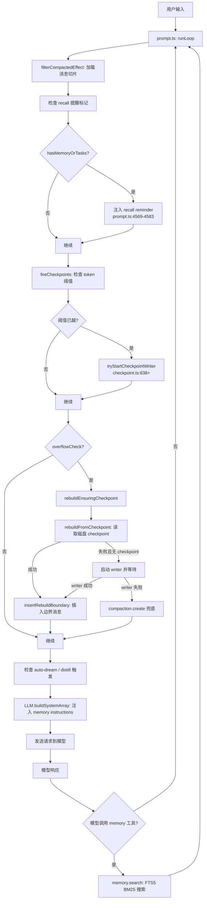

# MiMoCode Memory 系统真实运行链路审计报告

> 审计范围：`D:\EchoCore\MiMo-Code\packages\cli\src\` 下 Memory 检索、写入、持久化、Checkpoint、Auto-Dream/Distill 的完整调用链。
> 证据等级：**VERIFIED**（代码+运行证据）/ **IMPLEMENTED_UNVERIFIED**（代码存在但未运行验证）/ **PARTIAL**（部分实现）/ **DESIGN_ONLY**（仅设计或 Prompt 约定）/ **NOT_IMPLEMENTED**（未实现）/ **UNKNOWN**（无法确认）
> 本报告只做只读审计，未修改任何代码。

---

## 1. 用户输入 → 模型调用链

### 编号步骤

| # | 步骤 | 文件:行号 | 证据等级 |
|---|------|-----------|----------|
| 1 | 用户输入进入 `prompt()` 函数 | `session/prompt.ts` (~L4000+) | VERIFIED |
| 2 | runLoop 每步调用 `MessageV2.filterCompactedEffect` 加载消息切片 | `session/prompt.ts:4494-4498` | VERIFIED |
| 3 | 对最后一条 user 消息检查 recall 提醒标记，若无则注入 recall reminder | `session/prompt.ts:4569-4583` | VERIFIED |
| 4 | 每步调用 `prune.fireCheckpoints` 检查 token 阈值是否触发 checkpoint | `session/prompt.ts:4779-4790` | VERIFIED |
| 5 | 每步检查 `overflowCheck`，若溢出则走 rebuild 路径 | `session/prompt.ts:4792-4895` | VERIFIED |
| 6 | rebuild 走 `rebuildEnsuringCheckpoint` → `rebuildFromCheckpoint` → `renderRebuildContext` | `session/prompt.ts:955-1058` | VERIFIED |
| 7 | `renderRebuildContext` 读取 checkpoint.md / MEMORY.md / notes.md / global MEMORY.md，注入到重建上下文 | `session/checkpoint.ts:1252-1597` | VERIFIED |
| 8 | 重建后通过 `insertRebuildBoundary` 插入合成 checkpoint 边界消息 | `session/checkpoint.ts:1644-1775` | VERIFIED |
| 9 | 每步检查 auto-dream / auto-distill 触发（仅 step=1 且非 parent session） | `session/prompt.ts:4649-4682` | VERIFIED |
| 10 | `LLM.buildSystemArray` 注入 `buildMemoryInstructions`（系统提示中的 Memory 使用说明） | `session/llm.ts:351-365` | VERIFIED |
| 11 | 工具执行：模型可调用 `memory` 工具触发 FTS 搜索 | `tool/memory.ts:18-77` | VERIFIED |

### Mermaid 流程图



---

## 2. Memory 检索时机

### 何时触发？

Memory 检索有**三个独立触发时机**：

| 触发时机 | 代码路径 | 证据等级 |
|----------|----------|----------|
| **Bootstrap 时**（进程启动） | `project/bootstrap.ts:52` 调用 `Memory.Service.reconcile()`（后台 forkDetach） | VERIFIED |
| **每次 search 调用前**（lazy reconcile） | `memory/service.ts:59-64` 检查 `cfg.checkpoint.memory_reconcile_on_search ?? true`，为 true 时先 `reconcileMemory` | VERIFIED |
| **rebuild 渲染前** | `session/checkpoint.ts:1497` 在 `renderRebuildContext` 中调用 `memory.reconcile()` | VERIFIED |

**【事实】** 检索（search）本身不是由系统自动触发的，而是由模型主动调用 `memory` 工具时才执行。

### 谁触发？（代码路径）

1. **模型通过 `memory` 工具调用** → `tool/memory.ts:27` 调用 `memory.search()`
2. **Bootstrap 进程启动** → `project/bootstrap.ts:52` 调用 `svc.reconcile()`（索引预热，非检索）
3. **rebuild 上下文渲染** → `session/checkpoint.ts:1497` 调用 `memory.reconcile()`（索引同步，非检索）

### 检索结果如何进入上下文？

- **主动路径**：模型调用 `memory({ operation: "search", query: ... })` → FTS5 BM25 搜索 → 返回 snippet 列表作为 tool_result 进入模型上下文。
- **被动路径（rebuild）**：`renderRebuildContext` 从磁盘直接读取 checkpoint.md / MEMORY.md / notes.md / global MEMORY.md 的文件内容，作为合成文本注入 checkpoint 边界消息，不经过 FTS。
- **记忆键索引**：`renderRebuildContext` 还查询 FTS 表（`session/checkpoint.ts:1506-1536`）列出当前 session/project/global 范围内所有 memory 文件路径（不含已推送的），以"Memory keys index"节注入。

### 检索实现细节

**FTS5 搜索**（`memory/service.ts:52-138`）：
- 查询构建：`buildFtsQuery`（`memory/fts-query.ts:28-38`）将自由文本分词，每个 token 用短语引号包裹，OR 连接。CJK 通过 `\p{L}` Unicode 正则支持。
- BM25 排序：`ORDER BY bm25(memory_fts_idx)`，返回值取负（score = -bm25_score，越大越好）。
- 相对分数地板：默认 `floorRatio = 0.15`，保留得分 >= 最高分 × 0.15 的结果，第 1 条永远保留。可配置（`memory_search_score_floor`），设 0 关闭。
- 过采样：`fetchLimit = min(limit * 3, 50)`，供地板裁剪后仍有足够结果。
- FTS 虚拟表：`memory_fts_idx`（external content FTS5），由 trigger 从 `memory_fts` 表同步（`migration/20260521020000_memory_fts_triggers/migration.sql:8-17`）。

**证据等级：全部 VERIFIED**

---

## 3. Memory 写入链路

### 模型如何产生写入请求？

Memory 写入有**四条路径**：

| 写入者 | 写入什么 | 代码路径 | 证据等级 |
|--------|----------|----------|----------|
| **Checkpoint Writer 子代理** | checkpoint.md / MEMORY.md / notes.md / tasks/\*/progress.md | `session/checkpoint.ts:972-994` spawn 后由 writer LLM 通过 write/edit 工具写入 | VERIFIED |
| **主代理** | MEMORY.md（例外场景）、notes.md | `session/llm.ts:113-138` 系统提示中教主代理何时可直接编辑 MEMORY.md/notes.md | VERIFIED |
| **任务子代理** | tasks/\*/\*.md（progress.md / notes.md） | `session/prompt.ts:7010` 传 taskId；`plugin/subagent-progress-checker.ts` postStop 钩子强制写 progress.md | VERIFIED |
| **Dream / Distill 子代理** | 项目记忆文件、skills/agents/commands | `agent/agent.ts:350-424` 工具白名单含 write/edit/memory | VERIFIED |

**【推论】** 主代理大多数情况下不直接写 memory，而是由 checkpoint-writer 子代理在阈值触发时统一提取和写入。系统提示（`llm.ts:113-124`）明确教主代理"这些是例外而非常规"。

### 写入请求经过哪些门控？

```
写入工具 (write/edit/apply_patch/notebook_edit)
  └→ assertWriteAllowed (tool/external-directory.ts:102-141)
       ├→ 1. assertExternalDirectoryEffect: 外部目录权限询问（memory 树豁免）
       ├→ 2. assertAgentWriteSandbox (tool/memory-path-guard.ts:23-57)
       │     ├─ checkpoint-writer: 仅允许写 memory 树
       │     └─ dream/distill: 允许写 memory 树 + <worktree>/.mimocode/
       └→ 3. assertMemoryWriteAllowed (tool/memory-path-guard.ts:159-247)
             ├─ writeEnabled 门控（isMemoryWriteEnabled）
             ├─ scope 校验（global/projects/sessions）
             ├─ checkpoint-writer 白名单（memory.md/MEMORY.md、checkpoint.md、notes.md、tasks/<TID>/*.md）
             ├─ 主代理保留路径（<sid>/tasks/* 仅 writer 可写）
             └─ 任务绑定子代理可写自己的 tasks/<TID>/ 子树
```

**证据等级：全部 VERIFIED**（`tool/external-directory.ts:102-141`、`tool/memory-path-guard.ts:23-57,159-247`）

### 数据如何持久化？

| 存储层 | 内容 | 代码路径 | 证据等级 |
|--------|------|----------|----------|
| **文件系统** | checkpoint.md / MEMORY.md / notes.md / tasks/\*/progress.md / global MEMORY.md | `session/checkpoint-paths.ts:15-86` | VERIFIED |
| **SQLite（memory_fts）** | FTS 索引表（path/scope/scope_id/type/body/fingerprint/last_indexed_at） | `memory/fts.sql.ts:3-19` | VERIFIED |
| **SQLite（memory_fts_idx）** | FTS5 虚拟索引（external content 模式，由 trigger 同步） | `migration/20260521020000_memory_fts_triggers/migration.sql` | VERIFIED |

**【事实】** Memory 的"权威源"是文件系统上的 Markdown 文件。SQLite 中的 `memory_fts` 表是**索引/缓存**，通过 `reconcileMemory` 从磁盘同步。`memory_fts_idx` 是 FTS5 虚拟表，由 SQLite trigger 自动从 `memory_fts` 的 body 列维护。

---

## 4. Checkpoint Writer 链路

### 如何 spawn？

```
prune.fireCheckpoints (prune.ts:241)
  └→ SessionCheckpoint.tryStartCheckpointWriter (checkpoint.ts:638)
       ├─ 门控：Flag.MIMOCODE_DISABLE_CHECKPOINT → skip
       ├─ 门控：!isMemoryWriteEnabled → skip
       ├─ 并发：writers Map 已有 session → queue（1-slot pending，newest wins）
       ├─ 门控：isSystemSpawned(sessionID, "main") → skip
       ├─ 消息切片：filterCompactedEffect(agentID: "main")
       ├─ 计算边界：computeBoundary + adjustBoundaryForApiInvariants
       ├─ 确保目录 + 模板文件存在
       ├─ 构建 ForkContext（fork:true 父前缀缓存 | fork:false 冷启动 delta）
       ├─ 创建子 session（writerChildSession）
       └→ actor.spawn(mode: "subagent", agentType: "checkpoint-writer", background: true)
            tools: ["read","write","edit","apply_patch","glob","grep","task"]
```

**证据等级：VERIFIED**（`session/checkpoint.ts:638-1113`、`session/prune.ts:241-423`）

### 写入什么？

由 `checkpoint-writer.txt` 提示模板定义（`agent/prompt/checkpoint-writer.txt`）：

| 文件 | 内容 | 证据等级 |
|------|------|----------|
| `checkpoint.md` | 11 个节：Active intent / Next action / Directives / Task tree / Current work / Files / Discovered knowledge / Errors / Live resources / Design decisions / Open notes | VERIFIED |
| `MEMORY.md` | 4 个节：Project context / Rules / Architecture decisions / Discovered durable knowledge | VERIFIED |
| `notes.md` | 重置为 NOTES_TEMPLATE（writer 在 reconcile 后清空） | VERIFIED |
| `tasks/<id>/progress.md` | 由子代理写入，writer 只读取整合，不直接写 | VERIFIED |

Writer prompt 由 `composeWriterPrompt`（`checkpoint.ts:361-402`）组装，包含绝对路径 pin + progressDiff + SECTION_BUDGETS。

### 何时触发？

| 触发条件 | 代码路径 | 证据等级 |
|----------|----------|----------|
| **Token 阈值**（默认 40%/60%/80% 窗口） | `prune.fireCheckpoints`，每 runLoop 步骤检查 | VERIFIED |
| **上下文溢出**（rebuild 确保路径） | `prompt.ts:4832-4847` → `rebuildEnsuringCheckpoint` → `tryStartCheckpointWriter` | VERIFIED |
| **最终阈值失败恢复门** | `prune.ts:304-415`：transient 失败后，在 `firedAt + step` 处 re-fire | VERIFIED |

**水位推进不变量**：`last_checkpoint_message_id` **仅在 writer 成功时推进**（`checkpoint.ts:1025-1033`）。失败时水位不动，下次阈值重新覆盖同一区间。

**证据等级：VERIFIED**

---

## 5. Auto-Dream / Distill 链路

### 触发条件？

| 条件 | 代码路径 | 证据等级 |
|------|----------|----------|
| `cfg.dream.auto === true` | `auto-dream.ts:114` | VERIFIED |
| `cfg.distill.auto === true` | `auto-dream.ts:127` | VERIFIED |
| `isMemoryWriteEnabled(cfg)` 为 true | `auto-dream.ts:113,126` | VERIFIED |
| 距上次 dream spawn >= 10s（MIN_SPAWN_GAP_MS） | `auto-dream.ts:117,130` | VERIFIED |
| 距上次 Auto Dream session 的 time_created >= interval_days（默认 7 天） | `auto-dream.ts:54-99` | VERIFIED |
| 项目年龄 >= interval_days（首次触发前检查） | `auto-dream.ts:73-92` | VERIFIED |
| step === 1 且非 parent session（即新顶层 session 的第一步） | `prompt.ts:4649` | VERIFIED |

### 写入什么？

- **Dream**（`auto-dream.ts:27-33`）：任务提示为"从 memory 文件 + SQLite 轨迹数据库中整理持久性项目记忆"。Prompt 定义在 `agent/prompt/dream.txt`。Dream agent 有 write/edit/memory/bash 权限（`agent/agent.ts:350-388`）。
- **Distill**（`auto-dream.ts:35-43`）：任务提示为"审查过去一个月的 session，识别重复手动工作流并打包为 skills/agents/commands"。

### 与 Memory 的关系？

- **写入门控**：`isMemoryWriteEnabled` 为 false 时 auto-dream/distill 均跳过（`auto-dream.ts:113,126`）。
- **写入沙箱**：`assertAgentWriteSandbox` 允许 dream/distill 写 memory 树 + `<worktree>/.mimocode/`（`memory-path-guard.ts:9,46-56`）。
- **工具白名单**：dream/distill 均可使用 `memory` 搜索工具（`agent/agent.ts:366,405`）。
- **独立 session**：dream/distill 各创建一个新 session（title 为 "Auto Dream"/"Auto Distill"），由 `AppRuntime.runPromise` 后台执行（`prompt.ts:4661-4681`）。

**证据等级：全部 VERIFIED**

---

## 6. 后台任务

### Reconcile 何时跑？

| 时机 | 代码路径 | 特征 | 证据等级 |
|------|----------|------|----------|
| **Bootstrap**（进程启动） | `project/bootstrap.ts:52-57` | forkDetach（不阻塞启动），失败仅警告 | VERIFIED |
| **每次 memory.search 前** | `memory/service.ts:59-64` | 受 `memory_reconcile_on_search` 控制（默认 true） | VERIFIED |
| **renderRebuildContext 前** | `session/checkpoint.ts:1497` | Effect.ignore（失败不中断） | VERIFIED |

### Bootstrap 时做什么？

`project/bootstrap.ts:21-68` 的完整顺序：

1. 加载 Config（`Config.Service.get()`）
2. 初始化 Plugin（可修改 config）
3. 清扫 abandoned actor zombie（`sweepAbandonedZombies`）
4. 并行 forkDetach 初始化：LSP / ShareNext / Format / File / FileWatcher / Vcs / Snapshot / WriterService
5. **Memory reconcile**（forkDetach，不阻塞启动）← 关键步骤
6. 订阅 Command.Event.Executed
7. Metrics 订阅

**证据等级：VERIFIED**

### 定时任务有哪些？

| 任务 | 周期 | 触发方式 | 证据等级 |
|------|------|----------|----------|
| Auto Dream | 默认 7 天（`interval_days`） | 新顶层 session 第一步检查 | VERIFIED |
| Auto Distill | 默认 30 天（`interval_days`） | 新顶层 session 第一步检查 | VERIFIED |
| Checkpoint 阈值触发 | 每 runLoop 步骤检查 | `fireCheckpoints` | VERIFIED |
| Memory reconcile | 每次 search 前 / bootstrap | lazy | VERIFIED |

**【事实】** 没有独立的 cron/timer 后台线程。Auto Dream/Distill 是"拉"模型——在新 session 启动时检查时间间隔，满足条件则 spawn。没有 push 型定时器。

---

## 7. 故障/重启/并发处理

### Memory 写入失败时如何处理？

| 场景 | 处理方式 | 代码路径 | 证据等级 |
|------|----------|----------|----------|
| **Writer LLM 失败** | 水位不推进；下次阈值重新覆盖；最终阈值有 transient 失败恢复门 | `checkpoint.ts:1034-1067`、`prune.ts:330-415` | VERIFIED |
| **Writer 写入被 path-guard 拒绝** | 工具返回错误，writer 看到错误后可能重试或放弃 | `memory-path-guard.ts:37-56,208-247` | VERIFIED |
| **`memory.disable_write=true`** | 全链路短路：writer 不 spawn、模板不创建、rebuild 直接走 compaction、auto-dream/distill 不触发、path-guard 拒绝所有 memory 写入 | `write-gate.ts:31-33`、`checkpoint.ts:664-667`、`prompt.ts:986` | VERIFIED |
| **Reconcile 失败** | bootstrap 时仅警告不阻塞；search 时受 `Effect.promise` 包裹 | `bootstrap.ts:52-57`、`service.ts:63` | VERIFIED |

### 重启后如何恢复？

| 恢复机制 | 说明 | 代码路径 | 证据等级 |
|----------|------|----------|----------|
| **文件系统持久化** | checkpoint.md / MEMORY.md 等文件在磁盘上，重启后可直接读取 | `checkpoint-paths.ts` | VERIFIED |
| **Bootstrap reconcile** | 启动时重新索引磁盘文件到 FTS 表（fingerprint 比较，仅更新变更文件） | `bootstrap.ts:52`、`reconcile.ts:46-92` | VERIFIED |
| **水位持久化** | `last_checkpoint_message_id` 存在 SessionTable 列中，跨重启保留 | `checkpoint.ts:1636`、`migration/20260519000000_last_checkpoint_message_id` | VERIFIED |
| **Writer 进程死亡** | Deferred 未 resolve 时，`waitForWriter` 5 分钟超时返回 "timeout"；下次阈值重新触发 | `checkpoint.ts:1115-1157` | VERIFIED |

### 并发写入如何处理？

| 场景 | 处理方式 | 代码路径 | 证据等级 |
|------|----------|----------|----------|
| **同一 session 多次请求 writer** | 1-slot pending queue，newest wins（旧 pending 被驱逐） | `checkpoint.ts:669-681` | VERIFIED |
| **Writer 已在运行** | `fireCheckpoints` 跳过新阈值触发（不 consume threshold） | `prune.ts:272-277` | VERIFIED |
| **并发 migrateProjectMemory** | ENOENT 视为对方赢，真实 FS 错误重新抛出 | `checkpoint-paths.ts:48-60` | VERIFIED |
| **并发 reconcile** | SQLite 单写者；`onConflictDoUpdate` 按 path 唯一键 upsert | `reconcile.ts:66-90` | VERIFIED |
| **跨进程写入（无锁）** | 文件系统写入无跨进程锁；SQLite 有 WAL 模式（由驱动管理）。writer 写入是原子文件替换（`Bun.write`） | 代码中未发现跨进程文件锁 | IMPLEMENTED_UNVERIFIED |

**【推论】** 并发场景下，两个进程同时对同一 memory 文件写入时可能丢失更新（last-writer-wins）。fingerprint 机制（size-mtime）只用于索引去重，不用于乐观锁。

---

## 8. 已实现 vs 仅接口 vs 仅 Prompt 约定

### 已实现（VERIFIED / IMPLEMENTED_UNVERIFIED）

| 能力 | 等级 | 证据 |
|------|------|------|
| FTS5 BM25 检索（含 CJK、OR-join、相对分数地板） | VERIFIED | `memory/service.ts:52-138`、`fts-query.ts:28-38` |
| Reconcile（fingerprint 增量索引 + 双向 prune） | VERIFIED | `memory/reconcile.ts:46-144` |
| Memory 写入门控（write-gate + path-guard + agent sandbox） | VERIFIED | `write-gate.ts:31-33`、`memory-path-guard.ts`、`external-directory.ts:102-141` |
| Checkpoint Writer spawn + fork + 水位推进 | VERIFIED | `checkpoint.ts:638-1113` |
| Checkpoint 阈值触发（默认 40%/60%/80%） | VERIFIED | `prune.ts:241-423` |
| Rebuild 上下文注入（checkpoint/MEMORY/notes/global 全文 + FTS keys index） | VERIFIED | `checkpoint.ts:1252-1597` |
| Recall reminder（每 user 消息条件注入） | VERIFIED | `prompt.ts:4569-4583` |
| System prompt memory instructions 注入 | VERIFIED | `llm.ts:351-365`、`llm.ts:84-173` |
| Auto Dream / Distill 触发 + spawn | VERIFIED | `auto-dream.ts`、`prompt.ts:4649-4682` |
| Memory 工具注册 + 执行 | VERIFIED | `tool/registry.ts:164,248`、`tool/memory.ts` |
| Bootstrap reconcile（后台） | VERIFIED | `bootstrap.ts:52-57` |
| Subagent progress checker（postStop 钩子） | VERIFIED | `plugin/subagent-progress-checker.ts` |
| memory.md → MEMORY.md 迁移 | VERIFIED | `checkpoint-paths.ts:48-60` |
| FTS trigger 维护（external content FTS5） | VERIFIED | `migration/20260521020000_memory_fts_triggers` |
| Write 水位推进不变量（成功才推进） | VERIFIED | `checkpoint.ts:1025-1033` |
| Rebuild 边界 microcompact（可压缩工具 result 替换） | VERIFIED | `checkpoint.ts:1728-1772` |

### 仅 Prompt 约定（DESIGN_ONLY / 部分 VERIFIED）

| 能力 | 等级 | 说明 |
|------|------|------|
| 主代理"仅在例外时编辑 MEMORY.md" | DESIGN_ONLY | 系统提示教了规则（`llm.ts:113-124`），但代码不强制——主代理仍可直接 edit MEMORY.md |
| 主代理"不得编辑 checkpoint.md" | DESIGN_ONLY | 系统提示教了（`llm.ts:142`），但 path-guard 的白名单允许主代理写 checkpoint.md（`memory-path-guard.ts:130-132` 注释说"Main agent CAN write <pid>/MEMORY.md and <sid>/checkpoint.md"） |
| "notes.md 是唯一合法 scratchpad" | DESIGN_ONLY | 系统提示教了（`llm.ts:138`），代码不限制主代理创建其他 memory 树下的文件（path-guard 允许有效 scope 下任意 `<key>.md`） |
| "checkpoint.md 11 节结构由 writer 维护" | DESIGN_ONLY | writer prompt 要求（`checkpoint-writer.txt:12-23`），但 writer 是 LLM，不保证 100% 遵守 |
| "Dream 不修改 SQLite 数据库" | DESIGN_ONLY | Dream prompt 要求（`dream.txt:22`），但 bash 权限允许技术上写入 |
| Memory 内容的准确性/时效性 | DESIGN_ONLY | 索引了 body 但不验证内容是否仍然正确 |

### 未实现 / 部分实现

| 能力 | 等级 | 说明 |
|------|------|------|
| Memory 写入的跨进程锁 | NOT_IMPLEMENTED | 未发现跨进程文件锁机制；并发写入依赖 last-writer-wins |
| Memory 写入失败的自动重试 | PARTIAL | Writer 的 LLM 调用有 retry ladder，但文件写入失败无专门重试 |
| Memory 内容的自动过期/TTL | NOT_IMPLEMENTED | 无过期机制；reconcile 只 prune 磁盘上已删除的文件 |
| Memory 写入的审计日志 | NOT_IMPLEMENTED | 无专门审计日志；仅有 Log.info 级别记录 |
| 搜索结果的重排序（Rerank） | NOT_IMPLEMENTED | 仅 BM25 排序，无 cross-encoder 或 LLM rerank |
| 增量/流式 Memory 注入 | NOT_IMPLEMENTED | rebuild 时全量注入（有 token budget），非增量 |

---

## 附录：关键文件索引

| 文件 | 职责 |
|------|------|
| `memory/service.ts` | Memory 搜索服务（FTS5 BM25） |
| `memory/reconcile.ts` | 磁盘 ↔ SQLite 索引同步 |
| `memory/write-gate.ts` | 写入开关（`memory.disable_write`） |
| `memory/fts-query.ts` | FTS5 查询构建（分词 + OR-join） |
| `memory/paths.ts` | 路径解析（scope/type/fingerprint） |
| `memory/fts.sql.ts` | memory_fts 表定义 |
| `tool/memory.ts` | Memory 搜索工具 |
| `tool/memory-path-guard.ts` | 写入路径守卫 |
| `tool/external-directory.ts` | 统一写入门控 |
| `session/checkpoint.ts` | Checkpoint Writer 生命周期 + rebuild |
| `session/checkpoint-paths.ts` | Memory 文件路径 |
| `session/checkpoint-templates.ts` | 文件模板 + 节预算 |
| `session/auto-dream.ts` | Auto Dream/Distill 触发判断 |
| `session/prompt.ts` | 主循环（recall/阈值/溢出/dream 触发） |
| `session/prune.ts` | Token 阈值触发 checkpoint |
| `session/llm.ts` | System prompt memory instructions 注入 |
| `session/message-v2.ts` | filterCompacted / compaction projection |
| `project/bootstrap.ts` | 启动时 memory reconcile |
| `agent/agent.ts` | checkpoint-writer / dream / distill agent 定义 |
| `agent/prompt/checkpoint-writer.txt` | Writer 提示模板 |
| `agent/prompt/dream.txt` | Dream 提示模板 |
| `plugin/subagent-progress-checker.ts` | Subagent progress.md postStop 检查 |
| `migration/20260521020000_memory_fts_triggers` | FTS trigger 迁移 |
