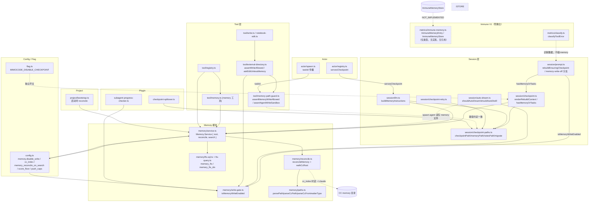

# Memory 系统依赖关系审计

审计日期：2026-11-03
审计范围：`D:\EchoCore\MiMo-Code\packages\cli\src\` 下 Memory 与 Echo Core 其他系统的接口、调用关系与数据依赖
方法：只读 Grep + 源码精读（未修改任何代码）
证据等级约定：
- **VERIFIED**：源码中直接可读的调用/引用，行号可定位
- **IMPLEMENTED_UNVERIFIED**：代码已实现但未运行验证行为
- **PARTIAL**：接口存在但覆盖不完整
- **DESIGN_ONLY**：仅设计文档或类型定义，无运行时实现
- **NOT_IMPLEMENTED**：设计中有意图、代码中无对应
- **UNKNOWN**：证据不足

---

## 1. Memory ↔ Session 依赖

**结论：Session 是 Memory 最重的消费者与生产者（强耦合，双向）。**

### 1.1 Session → Memory（读与控制）

| 接口 | 调用方向 | 证据 | 等级 |
|------|---------|------|------|
| `Memory.Service` 注入 `session/llm.ts` | Session 消费 Memory | `src/session/llm.ts:286`（Requirements 含 `Memory.Service`）、`:297` | VERIFIED |
| `Memory.root()` 派生系统提示中的 memory 路径 | Session 读 Memory 根路径构建 `buildMemoryInstructions` | `src/session/llm.ts:81-88`（注释明示 memoryRoot 与 `Memory.root()` 一致）、`:84` `buildMemoryInstructions` | VERIFIED |
| `Memory.Service` 注入 `session/checkpoint.ts` | Session checkpoint 渲染 rebuild 上下文 | `src/session/checkpoint.ts:623`（Requirements）、`:629` | VERIFIED |
| `isMemoryWriteEnabled(config)` 短路 checkpoint writer | 写开关关闭 → 不 spawn writer | `src/session/checkpoint.ts:8` import、`:664` | VERIFIED |
| `isMemoryWriteEnabled` 短路 `rebuildEnsuringCheckpoint` | 写关闭 → rebuild 降级为 compaction，返回 `"memory-write-off"` | `src/session/prompt.ts:49` import、`:986` | VERIFIED |
| `hasMemoryOrTasks(sessionID)` | 决定是否向子代理注入 memory 提示 | `src/session/checkpoint.ts:509`（接口）、`:1202`（实现）、`src/session/prompt.ts:4572`（调用） | VERIFIED |
| `renderRebuildContext` 读 `checkpoint.md` / `MEMORY.md` / `notes.md` | 预算化读入 rebuild | `src/session/checkpoint.ts:1340-1351`（`readBudgeted*`）、`:1455/:1482/:1488` pushSection | VERIFIED |
| `RECALL_REMINDER_MARKER` | 会话头部注入 "session has memory at ..." 提示 | `src/session/prompt.ts:204`、`:221` | VERIFIED |

### 1.2 Session → Memory 文件路径（经 `checkpoint-paths`，非 Memory.Service）

路径解析模块 `session/checkpoint-paths.ts` 独立于 `Memory.Service`，直接拼接 `<data>/memory/...`：

| 函数 | 位置 | 被谁用 | 等级 |
|------|------|--------|------|
| `checkpointPath(sessionID)` | `src/session/checkpoint-paths.ts:22` | checkpoint.ts:747、checkpoint-retry.ts:32、checkpoint-progress-reconcile.ts:46、plugin/checkpoint-splitover.ts:48、memory-path-guard 测试 | VERIFIED |
| `memoryPath(projectID)` | `:29` | checkpoint.ts:748、checkpoint-retry.ts:54、plugin/checkpoint-splitover.ts:49 | VERIFIED |
| `notesPath(sessionID)` | `:66` | checkpoint.ts:750 | VERIFIED |
| `migrateProjectMemory(projectID)` | `:48` | llm.ts:363、checkpoint.ts:758/:1344（memory.md → MEMORY.md 大写迁移） | VERIFIED |
| `tasksDir(sessionID)` | 同文件 | checkpoint-progress-reconcile.ts:3、memory 写测试 | VERIFIED |

**架构观察**：Session 通过两条并行路径访问 Memory 数据——①`Memory.Service`（search/reconcile/root），②`checkpoint-paths` 直接文件 I/O。两条路径的根目录字符串约定必须人工保持一致（llm.ts:81 的注释即为此约定），无编译期强制。证据等级：VERIFIED。

### 1.3 Session → Memory（auto-dream / distill 自动化）

| 能力 | 证据 | 等级 |
|------|------|------|
| `shouldAutoDream` 先检查写开关 | `src/session/auto-dream.ts:2` import、`:113` | VERIFIED |
| `shouldAutoDistill` 先检查写开关 | `src/session/auto-dream.ts:126` | VERIFIED |
| dream/distill agent 类型在写沙箱白名单 | `src/tool/memory-path-guard.ts:9` `WRITE_SANDBOXED_AGENTS = {dream, distill}` | VERIFIED |
| dream/distill prompt 指令引用 memory 文件与 trajectory DB | `src/session/auto-dream.ts:28-39` | VERIFIED |

### 1.4 Session 内部其他触点

- `session/visibility.ts:45` — prune/bootstrap/memory/recall 扫描跳过项（注释级引用）
- `session/prune.ts:254` — 与 `LLM.buildSystemArray` 共享 memory gate 判断（注释级引用）
- `session/processor.ts` — **无** Memory 直接引用（Grep 0 命中）；仅使用 `classifyToolError`（Immune 诊断，见 §6）
- 各模型 prompt 模板（`session/prompt/*.txt`）— 文本层教导模型使用 `memory` 工具（如 `default.txt:13`、`gpt.txt:218-222`），属 DESIGN/UX 层依赖

---

## 2. Memory ↔ Tool 依赖

**结论：Tool 层是 Memory 的搜索入口 + 写路径守卫所在层（强耦合）。**

| 组件 | 职责 | 证据 | 等级 |
|------|------|------|------|
| `tool/memory.ts`（MemoryTool） | 包装 `Memory.Service.search` 为内置 `memory` 工具；schema 仅 `operation: "search"` | `src/tool/memory.ts:3` import、`:10`（enum 只有 search）、`:21` 取 Service、`:27` 调 search | VERIFIED |
| `tool/registry.ts` | 注册 MemoryTool 与 `Memory.defaultLayer` | `:10` import MemoryTool、`:61` import Memory、`:164` init、`:248` 注册为 `memory`、`:279` 加入工具列表、`:518` `Memory.defaultLayer` | VERIFIED |
| `tool/external-directory.ts`（`assertWriteAllowed` 总闸） | ①memory 树早退交给细粒度守卫；②查 `isMemoryWriteEnabled`；③调用 `assertAgentWriteSandbox` + `assertMemoryWriteAllowed` | `:7` import write-gate、`:11` import 两个 assert、`:39` memory 树 contains 早退、`:85-88` memoryWriteEnabled、`:125-132` 两个 assert 调用 | VERIFIED |
| `tool/memory-path-guard.ts` | `assertAgentWriteSandbox`（系统代理写沙箱）+ `assertMemoryWriteAllowed`（memory 树内 scope/保留路径/写开关） | `:23` / `:159` 定义；写开关拒绝文案 `:186-194` | VERIFIED |
| `tool/write.ts` / `tool/notebook-edit.ts` | 经 `askEditUnlessMemory` 跳过 memory 路径上的 edit 确认 | `write.ts:16/:45`、`notebook-edit.ts:13/:206` | VERIFIED |
| `tool/history.ts` | 0 命中时提示 "use memory search"（文案级交叉引用） | `history.ts:187`、`history.txt:3-5` | VERIFIED |

**写路径总闸链**：`write/edit/notebook_edit` → `assertWriteAllowed`（external-directory.ts）→ memory 树特化到 `assertAgentWriteSandbox`（系统代理边界）+ `assertMemoryWriteAllowed`（scope/保留路径/writeEnabled）。`bash` 不经此闸（memory-path-guard.ts:18-21 注释明确声明为 prompt 级纪律，已知缺口）。证据等级：VERIFIED。

---

## 3. Memory ↔ Project/Bootstrap 依赖

**结论：启动时强制全量 reconcile；失败不阻塞启动（弱依赖、可降级）。**

| 接口 | 证据 | 等级 |
|------|------|------|
| `Memory.Service.use(svc => svc.reconcile())` 在 bootstrap | `src/project/bootstrap.ts:17` import、`:51-54`（失败仅 Log.warn，不 fail boot） | VERIFIED |
| projectID → memory 目录的哈希映射 | `src/memory/paths.ts` `resolveProjectId`（12-hex）；测试 `test/memory/paths.test.ts:248-260` | VERIFIED |

---

## 4. Memory ↔ Config 依赖

**结论：Config 控制写开关、CC 索引、检索行为与 rebuild 预算；无环境变量级 memory 开关（checkpoint 有）。**

| 配置键 | 作用 | 证据 | 等级 |
|--------|------|------|------|
| `memory.disable_write`（Boolean，负向默认） | 关闭一切新 memory 写入；读路径保留 | `src/config/config.ts:335-340`；唯一读点 `src/memory/write-gate.ts:31-32`（`!== true` 语义） | VERIFIED |
| `memory.cc_index`（Boolean，默认 false） | 索引 `~/.claude/projects` 为 scope='cc' | `config.ts:341-344`；消费 `memory/service.ts:40/:48/:62` | VERIFIED |
| `checkpoint.memory_reconcile_on_search`（默认 true） | search 前懒 reconcile | `config.ts:326-328`；消费 `service.ts:61` | VERIFIED |
| `checkpoint.memory_search_score_floor`（默认 0.15） | BM25 相对阈值过滤 | `config.ts:329-332`；消费 `service.ts:83` | VERIFIED |
| `checkpoint.push_caps.memory_titles / global / memory / notes / checkpoint` | rebuild 各节 token 上限 | `config.ts:286-302`；消费 `checkpoint.ts:1340-1351`（默认 11k/10k/6k） | VERIFIED |
| `dream.auto` / `dream.interval_days`、`distill.*` | 自动 dream/distill | `config.ts:347-358`；消费 `auto-dream.ts:114-133` | VERIFIED |
| `MIMOCODE_DISABLE_CHECKPOINT`（env flag） | 关 checkpoint 系统（≠ memory.disable_write） | `src/flag/flag.ts:137-143`；测试 `checkpoint-memory-write.test.ts:111` 断言两者独立 | VERIFIED |

**注意**：`flag/flag.ts` 中**没有** `memory` 相关 env flag——memory 写开关仅存在于 config 文件层。`isMemoryWriteEnabled` 的全部调用点（5 处）：`session/prompt.ts:986`、`session/checkpoint.ts:664`、`session/auto-dream.ts:113/:126`、`tool/external-directory.ts:88`、`plugin/subagent-progress-checker.ts:99`（定义于 `memory/write-gate.ts:31`）。证据等级：VERIFIED。

---

## 5. Memory ↔ Plugin 依赖

**结论：插件层有两个真实触点 + 一个假阳性。**

| 组件 | 关系 | 证据 | 等级 |
|------|------|------|------|
| `plugin/subagent-progress-checker.ts` | 经 plugin client 远程读 config，再调 `isMemoryWriteEnabled` 决定是否提示子代理写 memory | `:6` import、`:95-99` memoryWriteEnabled、`:134-139` 写关则跳过 | VERIFIED |
| `plugin/checkpoint-splitover.ts` | 向 checkpoint 上下文注入 `checkpointPath`/`memoryPath` 绝对路径 | `:6` import、`:48-49` | VERIFIED |
| `plugin/xai.ts:547` | 注释中 "in-memory result" — **与 Memory 系统无关**（假阳性） | `xai.ts:547` | VERIFIED（排除） |

---

## 6. Memory ↔ Immune 依赖

**结论：当前为零耦合（zero coupling）。VERIFIED。**

### 6.1 证据链

1. **`metrics/immune-memory.ts` 自身**：仅导出 `ImmuneMemoryEntry` zod schema 与 `ImmuneMemoryStore` 接口（`immune-memory.ts:8-65`）。文件头注释明示："V1 只定义结构，不建设完整自主学习系统"、"免疫记忆存储接口（V1 只定义，不实现完整存储）"（`:1-2`、`:52-55`）。
2. **全 src Grep `ImmuneMemory|immune-memory`**：命中仅限 `metrics/immune-memory.ts` 文件内部（7 处均为自引用）。无任何其他模块 import 它。证据等级：VERIFIED。
3. **全 test Grep**：0 命中——ImmuneMemory 无任何测试。
4. **设计文档交叉验证**：`docs/immune-system-v1-design.md:32`（免疫记忆 = ⏳ 结构已定义，存储待实现）、`:111-117`（Immune Memory V1 只定义数据结构）、`:146-155`（免疫记忆存储列为 V2+ 缺失能力）。
5. **Immune 与 Memory（agent memory）共享的唯一间接交集**：`classifyToolError` 被 `session/prompt.ts:162` 与 `session/processor.ts:28` 调用，但这是错误分类诊断（`DiagnosticInfo`），**不读写 memory 文件树，不经过 `Memory.Service`**。证据等级：VERIFIED。

### 6.2 接口对照

| ImmuneMemory 接口 | Memory 系统对应物 | 耦合 |
|-------------------|-------------------|------|
| `ImmuneMemoryStore.add/find/updateConfidence/getVerified` | 无对应实现 | 无（DESIGN_ONLY） |
| `ImmuneMemoryEntry.verification_evidence` | 无对应 | 无 |
| `Memory.Service.search/reconcile/root` | Immune 侧无引用 | 无 |

**判定：Immune V1 的"免疫记忆"与 agent Memory 系统是两个平行命名空间，共享"memory"一词但零代码依赖、零数据流。** 设计文档也未提出二者合并的路线图。

---

## 7. Memory ↔ Actor/Subagent 依赖

**结论：间接强依赖——actor 的 taskId 传播是 memory 写守卫的输入；servesCheckpoint 判断控制 memory 指令注入。**

| 接口 | 证据 | 等级 |
|------|------|------|
| spawn 时 `taskId` 传播到 `Tool.Context.taskId`，使 memory-path-guard 放行 `tasks/<TID>/*.md` | `src/session/prompt.ts:7010`（schema describe 明示传播到 memory-path-guard）；守卫侧 `memory-path-guard.ts:230-237` | VERIFIED |
| `actor/registry.ts` 的 `servesCheckpoint` 判定 = memory-instructions 注入的单一真源 | `src/actor/registry.ts:433-442`（注释："Single source of truth for both the memory-instructions gate..."）；消费方 `session/llm.ts:308-317` | VERIFIED |
| `actor/spawn.ts` 注释：memory 树写仍由 memory-path-guard 管辖，`edit:deny` 继承不豁免 | `src/actor/spawn.ts:79-80`、`:198` | VERIFIED |
| dream/distill（actor 类型）写沙箱放宽到 `.mimocode/` | `memory-path-guard.ts:9/:46-56`；测试 `memory-path-guard.test.ts:643-731` | VERIFIED |
| 任务绑定子代理跨任务逃逸被拒 | 测试 `memory-path-guard.test.ts:544-570` | VERIFIED |

---

## 8. 依赖关系图（Mermaid）

---

## 9. 实际存在的接口 vs 仅设计意图

### 9.1 实际存在且可运行的接口（VERIFIED）

| 接口 | 定义处 |
|------|--------|
| `Memory.Service: { root(), reconcile(), search(input) }` | `memory/service.ts:19-31` |
| `reconcileMemory({ mimo, cc? })` | `memory/reconcile.ts:94` |
| `isMemoryWriteEnabled(cfg)` | `memory/write-gate.ts:31` |
| `assertMemoryWriteAllowed(input)` | `tool/memory-path-guard.ts:159` |
| `assertAgentWriteSandbox(input)` | `tool/memory-path-guard.ts:23` |
| `askEditUnlessMemory` | `tool/external-directory.ts`（write.ts/notebook-edit.ts 消费） |
| `memory` 工具（**仅 search**） | `tool/memory.ts:10`（`z.enum(["search"])`） |
| `checkpointPath/memoryPath/notesPath/migrateProjectMemory/tasksDir` | `session/checkpoint-paths.ts` |
| `parsePath/parseCcPath/parseCcFrontmatterType/buildPath/resolveProjectId` | `memory/paths.ts` |
| `buildFtsQuery` | `memory/fts-query.ts` |
| SQLite 表 `memory_fts` + 虚表 `memory_fts_idx`（FTS5 external content + triggers） | `memory/fts.sql.ts:4-17` |

### 9.2 仅设计意图 / 未实现（DESIGN_ONLY / NOT_IMPLEMENTED）

| 意图 | 证据 | 等级 |
|------|------|------|
| `ImmuneMemoryStore` 完整存储（add/find/updateConfidence/getVerified） | 仅接口声明，无实现类、无调用方、无测试 | DESIGN_ONLY |
| 免疫记忆接入 SQLite/文件系统 | 设计文档 `immune-system-v1-design.md:150` 列为 V2+ 缺失 | DESIGN_ONLY |
| memory 工具的 write 操作 | schema 硬编码 `enum(["search"])`，无 write | NOT_IMPLEMENTED（有意为之——写走文件+守卫） |
| 向量/语义检索 | 代码与依赖（package.json:83-191）中无 embedding/vector 库；检索纯 BM25 FTS5 | NOT_IMPLEMENTED |
| memory 条目级冲突解决 / 置信度 / TTL | 全 src 无对应逻辑；仅 fingerprint 去重与文件删除 prune | NOT_IMPLEMENTED |
| bash 命令写 memory 的硬拦截 | memory-path-guard.ts:18-21 明示 bash 不覆盖，仅 prompt 纪律 | 已知缺口（注释承认） |
| Immune 与 agent Memory 的桥接 | 两套命名空间无任何桥接代码或设计条目 | NOT_IMPLEMENTED |

### 9.3 关键数据流（文件系统为共享总线）

Memory 的**真实**数据面是文件系统 `<Global.Path.data>/memory/**` + SQLite `memory_fts*` 表：

1. **写入方**：主 agent（Write/Edit 经守卫）、checkpoint-writer 子代理（allowlist）、绑定 TID 的子代理（own tasks/）、dream/distill（memory 树 + `.mimocode/`）、bootstrap/reconcile（索引侧）。
2. **读取方**：`memory` 工具 search、checkpoint rebuild 渲染、hasMemoryOrTasks 探测、auto-dream/distill 的工作索引、系统提示中的路径教学。
3. **索引方**：bootstrap 全量 reconcile + search 前懒 reconcile（受 `memory_reconcile_on_search` 控制）。

`Memory.Service` 本身**不提供写 API**——写永远是"工具写文件 + 守卫放行 + reconcile 进建索引"的三段式。这是理解整个依赖图的锚点。
